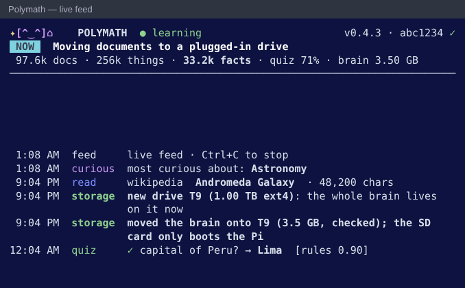
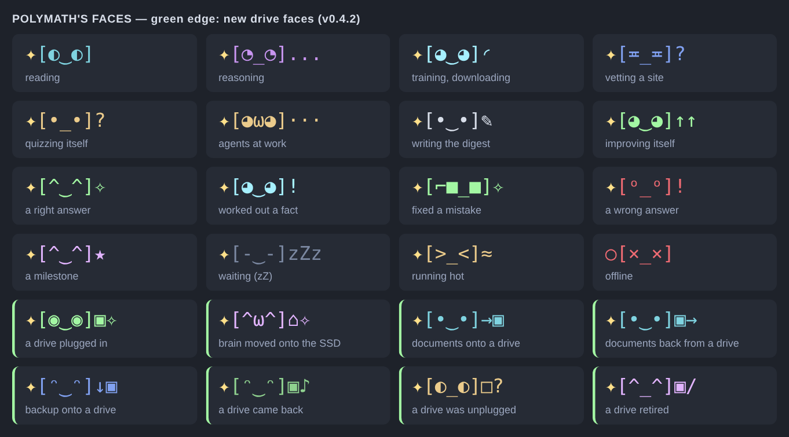

# Operations

## <a id="nvme"></a>1. Prepare the NVMe drive (once), or start on the SD card

Polymath prefers to keep its data off the SD card: a filesystem mounted at `/srv/polymath`.

**No drive yet?** `sudo ./install.sh --allow-sd-card` keeps the brain on the SD card for now:
- the budget is sized to the card (at most 15 GB, leaving 10 GB free);
- any drive you plug in later is added to the brain automatically (§8).

Constant database writes wear SD cards, so add a USB SSD when you can.

> **Warning:** `mkfs` erases the drive. Check the device name with `lsblk` first.

```bash
lsblk                                         # find the NVMe disk, e.g. /dev/nvme0n1
sudo mkfs.ext4 -L polymath /dev/nvme0n1p1     # ERASES the partition — only on an empty drive
sudo mkdir -p /srv/polymath
echo 'LABEL=polymath /srv/polymath ext4 defaults,noatime 0 2' | sudo tee -a /etc/fstab
sudo mount -a && findmnt /srv/polymath
```

If the drive already has a filesystem you want to keep, mount that one instead. A bind mount of a directory
on the NVMe drive also works.

## 2. Install, upgrade, uninstall

```bash
sudo ./install.sh              # first install and every upgrade (idempotent: safe to repeat)
sudo ./install.sh --allow-sd-card   # no NVMe yet: keep the brain on the SD card, add drives later
sudo ./install.sh --dry-run    # show what it would do
sudo ./uninstall.sh            # remove services and code; KEEPS /srv/polymath and /etc/polymath
sudo ./uninstall.sh --purge --yes   # also delete everything it learned, and its user
```

`install.sh` does the following:
- checks the mount;
- creates the `polymath` system user;
- installs `python3-venv`, `curl`, `fdisk` and `e2fsprogs` if missing;
- copies the code to `/opt/polymath/src` and builds `/opt/polymath/venv` (numpy only);
- records the build (version, git commit, commit date) in `/opt/polymath/build.json`. A new commit restarts the
  agent so that it runs, and reports, the installed build;
- writes `/etc/polymath/polymath.toml` (never overwritten once it exists);
- installs `polymath.service`, `polymath-dashboard.service` and a journald size limit;
- enables desktop autologin (`raspi-config nonint do_boot_behaviour B4`);
- adds the live feed terminal to the desktop user's autostart (XDG, labwc and wayfire), plus menu entries for the
  live feed and the dashboard. An upgrade replaces the dashboard autostart of earlier versions;
- installs the storage pool: a udev rule, `polymath-volume@.service` and `/mnt/polymath`, then adopts drives that
  are already plugged in (§8);
- comments out the `minecraft_*` settings of earlier versions in an existing configuration (backup:
  `polymath.toml.bak`). Left in place, they would be ignored with a warning;
- starts everything and waits for `/health`.

## 3. Everyday

| | |
|---|---|
| live feed | opens in a terminal at login · `polymath feed` in any terminal · menu: *Polymath live feed* |
| dashboard | `http://<pi>:8765/` · menu: *Polymath dashboard* |
| is everything working? | `polymath doctor`: brain, agent, internet, dashboard and disk, each with the fix if broken |
| status | `polymath status` · `systemctl status polymath polymath-dashboard` |
| logs | `journalctl -u polymath -f` (JSON lines; `-o cat` for compact) |
| nightly report | `/srv/polymath/reports/report-YYYY-MM-DD.md` or `polymath report` |
| research a topic | `polymath learn "topic"` or `polymath learn https://example.org/` |
| what it learned today | `polymath digest` (written daily at 07:00; also in the feed and on the dashboard) |
| new sites it vetted | `polymath sites` · `polymath sites --check example.org` |
| the week in review | `polymath recap` (Sundays at 08:00; `--now` for this week so far) |
| tell me about … | `polymath tell "topic"`, or ask "Tell me about …" on the dashboard |
| its predictions | `polymath predictions` (guessed before reading; confirmed, wrong, open) |
| SD card wear | `polymath wear` |
| on your phone | `http://<pi>:8765/live`: the face and the live feed |
| knowledge map | on the dashboard: topics clustered by what they share, sized by documents. ▶ plays the time-lapse; click a topic to ask about it |
| ask harder questions | `polymath ask "Is Brazil bigger than Angola?"` · "How far is Paris from Berlin?" · "Who was alive at the same time as Mozart?" · "What causes malaria?" · "Can penguins fly?" · "How do I …?" · "Who is the head of government of the capital of France?" |
| what it changed about itself | `polymath changes` (`--all` adds trials that changed nothing; `--json`), the dashboard panel *How it improved itself*, "improved" lines in the feed |
| overrule a tuned setting | `polymath changes --reset NAME` (or `all`): back to the default and pinned · `polymath changes --allow NAME` (or `all`) lets it tune again |

### How it improves itself

It never edits its code. What it changes, each change logged with the numbers behind it:

- **Settings**: every 8 hours it tests one setting against half/double (or a grid of) alternatives on the same
  questions and adopts a clearly better value. A new value is *watching* until two self-tests have run; if
  accuracy falls by more than 5 points it is undone by itself. Settings: `link.subjects`, `link.features`,
  `predict.min_confidence`, `infer.min_confidence`.
- **Rules**: every 6 hours each learned rule is checked against what sources later said. Rules that keep
  being contradicted are dropped with the facts only they produced; contradicted conclusions are withdrawn and
  never re-derived.
- **Specialists**: a relation it keeps getting wrong on the self-test (for example "fix birth place") gets its
  own *predict* agent (`polymath agents list` shows them, marked auto). They retire when the relation recovers,
  or after 21 days.
- **Reading**: daily it reads more of the sources and topics that teach it the most per CPU-minute (weights
  0.5–2, shown on the dashboard).
- **Writing**: it learns sentence phrasings from what it reads ("X was born in Y") and `tell` uses them.

The CLI reads the same configuration as the service (`/etc/polymath/polymath.toml`). `install.sh` puts
`polymath` on everyone's PATH (`/usr/local/bin/polymath`):
- most commands run as the `polymath` user, which owns the data, through `sudo`;
- `polymath feed` runs as you;
- `storage attach|detach|eject` run as root.

### The live feed

`polymath feed` shows what the agent is learning, as it happens:

| tag | what |
|---|---|
| `read` | a document arrived: Wikipedia article, paper, book, feed item, crawled page |
| `fact` / `disputed` | a fact it learned (from Wikidata, an infobox, or read in a sentence, quoted); disputed when sources disagree |
| `inferred` | a fact it derived with a learned rule (inverse, transitive, symmetric) |
| `reason` | rules learned (with examples), facts inferred, contradictions checked, how much it trusts each source |
| `quiz` | a self-test on a hidden fact: ✓ / ✗ with the truth, then the score against chance |
| `agent` | an agent's verified reward or penalty and what it was for; new and evolved agents |
| `curious` | the topics it most wants to learn about now |
| `you` | what you asked it to learn |
| `body` | throttling, pausing, back to normal, agent offline/online |
| `site` / `safety` | a new site approved, put on probation, refused (and why), or dropped; a safety list loaded |
| `relearn` / `fixed ✓` | reading up on a wrong self-test answer; getting it right on the re-test |
| `digest` | the daily "what I learned today" summary, line by line |
| `report` / `backup` / `error` | nightly report, backups, failed job slices (with retry or give-up) |

Busy streams are capped per refresh (for example 5 facts and 4 documents every 1.5 s), and the rest are counted
(`+4,312 more facts`), so a Wikidata ingest stays readable. The pinned header shows:
- the state, and the version top right;
- **a NOW line** with what it is doing right now, highlighted (cyan; yellow when paused; red when not running);
- its knowledge counts, the latest quiz score and the CPU temperature.

The feed window uses a larger font (14 pt) than other terminals. Change it with `POLYMATH_FEED_FONT_SIZE`, or
edit `~/.config/polymath-feed/lxterminal/lxterminal.conf` (your other terminals are not affected). The dashboard
and the `/live` page show the same NOW line as a large banner.

**On a small screen** (under 100 columns, like a Pi touchscreen) the feed packs itself:
- the header drops the cycle number and the date, and the counts use short numbers (`97.6k docs`). Whatever
  still does not fit is left out, least important first: the inferred/disputed detail, agents, rules, then the
  temperature (unless the Pi is hot);
- times leave out the seconds (` 9:04 PM`);
- messages wrap under their text instead of being cut off. Long runs of article titles are still cut short.



Times use a 12-hour clock (` 9:04:10 PM`), the same in the terminal and on `/live`. For a 24-hour clock, set
`POLYMATH_CLOCK=24` in the environment of the feed (and of the dashboard service, for `/live`).

**Version, top right.** `v0.2.0 · ab12cd3 · 2026-10-10 ✓` is the installed version, git commit and commit date;
`✓` means the running agent was started from exactly that build. `↻ agent still on v0.1.0` means an update is
installed but the agent has not restarted into it yet (`install.sh` restarts it; `sudo systemctl restart
polymath` does too). After an update the feed window reloads itself into the new code within 30 seconds, with
the line `updated to v… : reloading the feed`. `polymath version` prints the same check. It compares the Pi with
itself: it does not contact GitHub to look for newer commits.

**The face, top left.** A small animated character shows what it is doing, so the window is worth a glance:



| face | when |
|---|---|
| `[◐‿◐]` ⇄ `[◑‿◑]` | reading (eyes run along the line) |
| `[◔_◔]...` | reasoning, planning, going over mistakes |
| `[◕‿◕]◜` | training its models, downloading (spinner) |
| `[≖_≖]?` | vetting a new site |
| `[•_•]?` | quizzing itself |
| `[◕ω◕]···` | agents at work |
| `[•‿•]✎` | writing the digest or the nightly report |
| `[-‿-]zZ` | waiting for work (`[˘‿˘]zZ` at night) |
| `[^‿^]✧` ⇄ `[^ᵕ^]✦` | a right answer, a better quiz score, a site approved, a new agent, the digest |
| `[◕‿◕]!` | worked out a new fact by reasoning |
| `[⌐■_■]✧` | fixed an earlier mistake, a prediction came true, an improvement to itself |
| `[◕‿◕]↑↑` | improving itself (tuning, checking its rules, its reading strategy) |
| `[ᵒ_ᵒ]!` / `[¬_¬]?` / `[×_×]!` | a wrong answer / a contradiction or refused site / a failed job |
| `[^‿^]★` | a milestone (1, 2, 5 × 10ⁿ facts, documents or rules; also a feed line) |
| `[◉‿◉]▣✧` | a drive was plugged in and added to the brain (wide-eyed) |
| `[^ω^]⌂✦` | the whole brain moved into its new home on the SSD (also when that drive comes back) |
| `[•‿•]→▣` / `[•‿•]▣→` | moving documents onto a drive / bringing them back |
| `[ᵔ‿ᵔ]↓▣` | the nightly backup, landing on a drive |
| `[ᵔ‿ᵔ]▣♪` | a drive came back |
| `[◐_◐]□?` | a drive was unplugged: looking around for it |
| `[^_^]▣/` | a drive was retired: waving goodbye |
| `[>_<]` / `[-_-]` / `○[×_×]` | running hot / paused / agent offline |

The spark on its head (`✦`/`✧`) pulses while the agent is alive and it blinks every few seconds. There is no
language model and no randomness: the face is a function of the agent's state, the last few events and the clock.

The feed reads from the dashboard service (`/api/feed`, localhost), so the desktop user needs no access to
`/srv/polymath`. Options: `--plain` (no pinned header, for logs or `ssh`), `--no-color`, `--once`,
`--interval 3`, `--url http://<pi>:8765` (watch from another machine), `--direct` (read the database
directly, as a user who can). To stop the window opening at login, delete
`~/.config/autostart/polymath-feed.desktop` and the `open-feed.sh` lines in `~/.config/labwc/autostart` and
`~/.config/wayfire.ini`.

## 4. How it keeps the Pi healthy

| condition | mode | effect |
|---|---|---|
| CPU ≥ 75 °C (until < 72 °C) | throttle | light jobs only, half-length slices |
| CPU ≥ 82 °C (until < 77 °C) | pause | nothing runs |
| free disk < `disk_min_free_gb` | yield | light jobs only, half-length slices; eviction requested |
| free disk < half of that | pause | only eviction runs |
| data > `disk_budget_gb` | — | eviction requested |

These limits always apply, whatever the mode:
- `CPUQuota=200%` (2 of 4 cores), `MemoryMax=3G`, `Nice=10`, idle-ish IO priority;
- numpy is limited to 2 threads;
- the dashboard is limited to 25 % CPU and 1.2 GB (400 MB was too tight for the ask box on a big brain).

### <a id="always-on"></a>Always on (v0.5.1)

**Without the internet** it keeps working:
- **Noticing:** two failed connections in a row while reading, or failures at two different sites in one step
  with no site answering, mean offline. One dead website never counts. The feed shows `offline` and the face
  turns studious.
- **Holding back:** downloads, dump reading, crawling, feeds and site vetting wait. They keep their place and
  progress and never use up their retries, so a long outage loses nothing.
- **Studying:** reasoning, contradiction and sanity checks, predictions, rule audits, quizzes, self-tuning,
  duplicate merging, re-training from text and the agents run more often than usual (`drive/offline.py`).
- **Coming back:** it asks a server it already reads from (one small request) after 1, 2, 4 and 8 minutes, then
  every 10 minutes. The first answer brings it back: "back online after 3 h: reading again".

**The dashboard** cannot hang the live feed any more:
- requests run on a fixed pool of 8 threads, each with its own read-only connection;
- every query has a deadline: 4 s for the feed and health, 20 s for pages, then the request answers "busy";
- the expensive full-table counts are made by a background thread, never on a request;
- a question in the ask box no longer blocks every other page while it loads the answerer;
- it checks its own `/health` every 15 s and pings systemd only while it answers (`WatchdogSec=60`), so a stuck
  dashboard is restarted within a minute.

**The live feed** never goes dark. If the dashboard does not answer, it tries the database directly (when you
may read it) and then the agent's own snapshot, `/run/polymath/feed.json`. The agent writes that every 5
seconds, in memory, readable by everyone. The feed says which one it shows and what to run, and goes back to the
dashboard as soon as it answers.

**The brain's drive missing** (unplugged, a loose cable, a USB drop-out, or not mounted yet at boot):
- **The agent stays up.** It shows "paused — the brain lives on the drive …, which is not plugged in" in the
  feed and on the dashboard, and starts by itself within seconds of the drive being mounted again.
- **Before v0.5.2**, both services stopped and stayed stopped: the feed showed only "no answer".
- **The dashboard always starts**, even without the brain, and says why.

**It brings the brain's drive back by itself** (v0.5.5):
- `polymath-heal.timer` runs `polymath storage heal` 45 s after boot and then every minute. While the brain is
  healthy it does nothing.
- When the brain is missing or dead, it escalates:
  1. a dead or frozen mount (v0.5.7: one that does not answer at all) is dropped lazily, the USB drive behind it
     is reset, and the services are restarted without waiting on them; then the drive is asked for again;
  2. a USB drive reporting 0 bytes gets a soft reset of just that device;
  3. still missing after 90 s, the USB ports' power is cut for 20 s and restored (`uhubctl`). That is a real
     replug, for enclosures like the DockCase whose capacitor keeps the drive in "safe off" across a reboot. At
     most once every 15 minutes and 6 times a day.
- Every action goes to the caretaker's inbox and to `polymath doctor`. Settings: `[storage] heal`,
  `heal_power_cycle`, `heal_hubs`, `heal_power_off_s`; standby brain: `standby`, `standby_after_s`,
  `standby_budget_gb`, `standby_dir`.
- A drive reporting 0 bytes is never treated as blank and never formatted.
- **It keeps learning without its drive** (v0.6.0, `core/standby.py`):
  - after `[storage] standby_after_s` (5 min) with the brain's drive missing, frozen or dead, the agent starts a
    small, separate **standby brain** on the SD card (`/var/lib/polymath/standby`, systemd's
    `StateDirectory`) and learns there: feeds, the crawler, single Wikipedia articles, vetted sites. No dumps, no
    backups, no drive pool; at most `standby_budget_gb` (3 GB), with the SD card wear guard watching;
  - the feed's header says `learning on standby`, the face looks at its notes, and `doctor` shows a `standby`
    line; the caretaker's inbox records when it started;
  - a restart while the drive is still gone goes straight back to the standby brain (no second 5-minute wait);
  - when the drive is back (the storage helper restarts the agent, or the agent sees it within 30 s), the agent
    restarts on the real brain and folds the standby brain into it: its documents (through the normal store, so
    duplicates are recognised and the real brain reads them again with its whole graph), Wikidata records, the
    crawler's progress and the problems it noted. Then the standby brain is removed. The feed shows a `standby`
    line with how much moved;
  - folding only adds to the real brain, resumes where it stopped after a restart, and never runs twice;
  - switch it off with `[storage] standby = false`.
- **Nothing waits on a frozen drive** (v0.5.7): every look at the brain's storage goes through `core/fsprobe`, a
  child process with a time limit, so a drive that stops answering makes Polymath wait visibly, never hang.

**Every problem is recorded** (`core/issues.py`, the caretaker's inbox):
- what gets recorded: jobs that give up, body pauses (heat, full disk, read-only card), restart loops, unclean
  stops, time spent without the brain's drive, and a fallback snapshot that cannot be written;
- each one shows in the feed as a red or yellow `problem` line, and `polymath doctor` lists the last day's;
- the coming caretaker agent reads the same list.

**Restarts:** both services restart forever, waiting longer between attempts (up to 5 minutes for the agent and
1 minute for the dashboard), so they come back by themselves once whatever stopped them is fixed.

**SD card wear.** An SD card wears out from writes, and nothing on it reports its own wear, so Polymath measures
writes and estimates. Every 15 minutes it records the bytes written to the data disk and the system disk
(`/sys/dev/block/…/stat`), and the agent's own share (`/proc/self/io`):
- **rated life**: `capacity × sd_endurance_cycles ÷ sd_write_amplification` (1,000 and 3 by default, which
  is conservative for consumer cards). The daily budget makes that last `sd_target_years` (5);
- **over budget**: on the data disk it switches to saver mode, with twice-as-long job slices. Each slice is
  one commit, so fewer, larger commits write less. The feed and the digest say so once a day;
- **read-only**: a data disk the kernel turned read-only (the usual sign of a failing card) pauses everything,
  with that reason in the feed;
- **lower baseline**: idle cycles no longer write a heartbeat every 2 seconds (that was about 350 MB a day),
  and a busy job slice writes 25 % less than before (measured).

`polymath wear` shows the numbers ("SD card (data disk): 3.6 GB written in the last day, budget 11.7 GB/day; at
this rate it lasts about 6.6 years"). The figure is a rate, not the card's remaining life, because writes from
before Polymath was installed are unknown. **The permanent fix is a drive** (§8): plug one in and the brain
moves onto it.

The limits leave half the CPU and a quarter of the memory to the desktop. To give the agent the whole Pi, raise
them with a drop-in (`sudo systemctl edit polymath`, for example `CPUQuota=350%` and `MemoryMax=6G` on an 8 GB
Pi).

## 5. Backups and restore

- **Nightly backups** run at 03:00 local time (`body.backup_hour`):
  - SQLite's online backup API copies the database while the agent runs;
  - `PRAGMA quick_check` verifies the copy;
  - the copy is compressed with xz and stored in `/srv/polymath/backups/`;
  - the newest 7 are kept (`body.backup_keep`);
  - a backup is skipped, and logged, if the disk could not hold it.
- **On demand:** `polymath backup` · `polymath backup --list`.
- **Restore:**

  ```bash
  sudo systemctl stop polymath polymath-dashboard
  sudo -u polymath /opt/polymath/venv/bin/polymath restore polymath-20261009-030000.sqlite3.xz
  sudo systemctl start polymath polymath-dashboard
  ```

  The restore checks the backup's integrity before swapping it in, and keeps the replaced database as
  `polymath.sqlite3.pre-restore-<time>`.

The indexes under `/srv/polymath/index` are rebuilt from the database automatically if they are lost.

## 6. Power loss and crashes

Each job slice and its bookkeeping commit in one SQLite transaction (WAL, `synchronous=NORMAL`). After a power
cut:
- the agent restarts;
- interrupted jobs are re-queued from their last checkpoint;
- a job whose process died mid-slice 3 times is dead-lettered (`polymath status` lists dead jobs), so one bad
  input cannot loop forever.

The systemd watchdog (120 s) restarts a hung agent.

## 7. Configuration

Everything is optional; see the commented `/etc/polymath/polymath.toml`. Common changes:

```toml
[senses]
contact = "you@example.org"          # recommended by Wikimedia for dump users
feeds = ["https://example.org/feed"] # replaces the built-in feed list
seeds = ["https://docs.example.org/"]
stackexchange_sites = ["ai", "physics", "math"]
wikipedia_lang = "en"

[body]
disk_budget_gb = 400
```

**A second Wikipedia language** (`second_language = "es"` under `[senses]`; also `de`, `fr`, `it`, `pt`): about one
Wikipedia part in five is then read from that language, only for its infoboxes and tables, to back up or contest
facts. It is on automatically in big-brain mode.

**Big-brain mode** turns on by itself when the brain has a large drive (a budget of 400 GB or more, for example the
brain on your 1 TB SSD). It raises settings you have not set yourself: word vectors for 400,000 words, 40 OpenAlex and
PubMed files, 3,000 books, 15 Stack Exchange sites and Spanish Wikipedia as a second language. The changelog says
when it switches. Any of these set in `polymath.toml` stays as you set it.

Apply changes with `sudo systemctl restart polymath polymath-dashboard`.

## 8. Storage pool: drives you plug in

Plug a drive in and it becomes part of the brain. No commands are needed:

1. udev starts `polymath-volume@<device>.service`, which runs `polymath storage attach` as root.
2. The helper checks the drive and mounts it at `/mnt/polymath/<filesystem UUID>`, with a `polymath-brain/`
   folder and a manifest saying how much of it Polymath may use.
3. The agent notices within 30 seconds. The live feed shows `storage  new drive …`, and the header shows the
   total brain space.

| the drive | what happens |
|---|---|
| brand new, nothing on it (no partition table, no filesystem, zeros at both ends) | formatted: GPT, one ext4 partition labelled `POLYMATH`; 90 % of it becomes brain space |
| brand new from the shop: exFAT/NTFS/FAT, 32 GB or more, only the maker's installers and manuals on it | formatted ext4 `POLYMATH` **once** (see below), then the brain moves onto it |
| labelled `POLYMATH*`, or empty | dedicated: 90 % of its free space |
| already holds your files (ext4, exFAT, FAT, NTFS, btrfs, xfs) | shared: half its free space (`shared_drive_share`), always leaving 10 % free; **your files are never touched** |
| the system disk, SD card, encrypted/LVM/RAID/swap, unknown data, ignored or retired | left alone |

**What lives on drives.** Document bodies are the bulk of the database:
- once the main disk passes 75 % of its budget (`storage.spill_at`), the least valuable bodies move to the
  roomiest drive;
- eviction only starts when every drive is full;
- downloads and the nightly backups also go to drives.

The database, indexes and reports stay on the main disk.

**Unplugging.** The agent keeps running. Documents on that drive read as unavailable, and their facts and
metadata stay. They come back when the drive is plugged in again. For a clean removal:

```bash
polymath storage list                 # every drive: brain space, use, documents on it
sudo polymath storage eject <id>      # unmount cleanly, then unplug (for a short while)
polymath storage retire <id>          # bring its documents back (what no longer fits is evicted), then
                                      # unplug for good; it is never adopted again
```

### <a id="home"></a>Moving the brain onto a drive (your SSD)

While the brain is on the SD card, the first **dedicated, Linux-formatted** drive with room becomes its new home,
automatically:
- "dedicated" means it was blank and Polymath formatted it, or it is labelled `POLYMATH`, or it is empty;
- "room" means at least `home_min_gb` (32 GB) free, and three times the brain's size.

What happens:
1. the agent and the dashboard stop (each commits and exits cleanly);
2. `/srv/polymath` is copied to `polymath-brain/home` on the drive and checked: the same files and bytes, and
   SQLite's `quick_check` on the database. A 15 GB brain takes a few minutes;
3. the SD card's copy is moved aside to `/srv/polymath-sd-copy`, as a safety net. It is not deleted, and it is
   not used any more;
4. the drive's copy is mounted over `/srv/polymath` and everything starts again. The feed says `storage  moved
   the brain onto <drive>`, `polymath storage list` shows the main disk as that drive, and its budget is the
   drive's (90 % of it).

From then on, every boot mounts the brain from the drive before the agent starts. If the drive is missing, the
agent **waits** (`polymath status` / the journal: "the brain lives on the drive …, which is not plugged in") and
does not run on the old SD copy. Plug the drive back in and it starts by itself. `storage eject` refuses
while the agent runs on it.

**A new SSD straight from the shop** (most come formatted exFAT or NTFS, with the maker's software on them) is
formatted for Linux automatically and the brain moves onto it. Plug it in and wait a few minutes. It counts as
fresh only when all of these hold:
- it is 32 GB or more (`home_min_gb`), so USB sticks stay as they are;
- it holds nothing but the maker's installers and manuals (for example `SamsungPortableSSD_Setup_Win.exe`,
  `WD Discovery for Mac.dmg`, `Quick Start Guide.pdf`, under 1 GB in all) and system clutter
  (`System Volume Information`, `.DS_Store`…). **A single file or folder of yours, and it is not touched**;
- Polymath has not stored documents on it;
- it has never been formatted by Polymath before.

**It is formatted once per drive, ever.** Before formatting, Polymath writes the drive's serial number to
`/var/lib/polymath/formatted-drives.json` on the SD card. Unplugging it, a loose cable or a power cut never
causes a second format: after the first format the drive is Linux-formatted with Polymath's folder on it, so it
is recognised as the brain and simply mounted again. That holds even if the power fails during formatting, and
even if you later reformat it on a laptop and plug it back in. A drive that reports no serial number or model is
never formatted on its own.

Turn it off with `format_fresh_drives = false` under `[storage]`.

**A Windows or macOS drive with your files on it** is used for documents only. The feed tells you what to do.
Reformat it explicitly:

```bash
polymath storage list                              # find its id
sudo polymath storage format <id> --yes            # an empty drive: reformatted ext4, then the brain moves
sudo polymath storage format <id> --yes --erase-files   # it holds files (e.g. the maker's installers): erased
```

`format` lists the files first and refuses without `--erase-files`. It refuses outright if Polymath already
stored documents there.

When you are happy with the drive, free the SD card's space with `sudo rm -rf /srv/polymath-sd-copy` (optional).
To turn the move off: `move_home = false` under `[storage]`.

**Settings** (`[storage]` in `/etc/polymath/polymath.toml`):
- `adopt = false` stops adopting drives;
- `format_blank_disks = false` never formats a blank drive; `format_fresh_drives = false` never formats a fresh shop
  drive (both off: nothing is ever formatted on its own);
- `ignore = ["<uuid>"]` skips a drive (UUIDs are in `polymath storage list` and `lsblk -f`);
- `shared_drive_share` and `reserve_fraction` set how much of a drive is used.

The desktop no longer auto-mounts drives that Polymath adopts. Their files are under
`/mnt/polymath/<uuid>/` (read them with `sudo`), or `eject` the drive first.

## 9. Troubleshooting

| symptom | check |
|---|---|
| anything | `polymath doctor`: each broken part with the command that fixes it |
| service won't start | `journalctl -u polymath -b`; is `/srv/polymath` mounted (`findmnt /srv/polymath`)? |
| dashboard says "cannot reach the database" | `systemctl status polymath`; `ls -l /srv/polymath/db` |
| `/health` 503 | heartbeat older than 60 s: the agent is stopped, paused for heat, or hung (the watchdog restarts it) |
| not learning anything new | `polymath status` (dead jobs, queue) and `polymath why` (recent decisions) |
| too hot | improve cooling, or lower `throttle_celsius` / `pause_celsius` |
| live feed says "no answer from http://127.0.0.1:8765: showing … instead" | the dashboard is down or hung; the feed carries on from the agent's snapshot. systemd restarts a hung dashboard within a minute; to do it now: `sudo systemctl restart polymath-dashboard` (details: `journalctl -u polymath-dashboard -n 40`) |
| live feed says "waiting: …" (every source failed) | the agent is not running either: `polymath doctor`, then `sudo systemctl restart polymath` |
| the feed says "paused — the brain lives on the drive …, which is not plugged in" | the SSD dropped out or is not mounted: check its cable and power (a Pi 4 port can brown out a bus-powered SSD; a powered hub or the official 3 A supply helps), and that `lsblk` lists it. Polymath starts by itself once it is back |
| `lsblk` shows `sda 0B usb` (doctor: "reports 0 bytes") | the SSD's enclosure answers but the drive does not: unplug it for 10 s, plug it into a blue USB 3 port; if it recurs, power it from a powered hub or its own supply |
| `Job for polymath.service failed because a timeout was exceeded`, or doctor: "does not answer at all" | the brain's drive froze (reads never return). v0.5.7 waits instead of hanging and `storage heal` resets the drive within a minute or two. By hand: `sudo systemctl stop polymath-heal.timer; sudo umount -l /srv/polymath; sudo umount -l /mnt/polymath/*; sudo usbreset 31db:9210` (your enclosure's ID from `lsusb`), wait 10 s, `sudo systemctl restart 'polymath-volume@*' polymath polymath-dashboard; sudo systemctl start polymath-heal.timer`. A reboot or a replug also clears it |
| "Input/output error" on `/srv/polymath` (doctor: "its storage does not answer") | the SSD dropped out and came back as a new device; the old mount is dead. `sudo reboot` clears it (v0.5.4 also replaces a dead mount by itself when the drive is attached again) |
| the feed says `learning on standby` (doctor: `standby`) | the brain's drive has been gone for over 5 minutes, so Polymath learns on its small standby brain on the SD card. Nothing to do for Polymath: bring the drive back (see the rows above). What it read moves onto the drive by itself |
| anything else, or you want the whole picture | `polymath caretaker` (no sudo) gives the situation now, the recent problems with what each one is, and the next steps. `polymath caretaker known` lists every known problem, `polymath caretaker show <id>` gives its symptoms, causes, checks and fix, and `polymath caretaker history` lists what happened on this Pi |
| an update "did nothing" (the same problem after `git pull` and `install.sh`) | check what is installed: `cat /opt/polymath/build.json`, and which branch the clone is on: `git -C ~/Blazeffect83 branch -vv`. If the clone is on another project's branch, give Polymath its own folder without touching that one: `git -C ~/Blazeffect83 fetch origin claude/polymath-agent && git -C ~/Blazeffect83 worktree add ~/polymath-src origin/claude/polymath-agent`, then `cd ~/polymath-src/polymath && sudo ./install.sh --allow-sd-card` |
| doctor: `/dev/sda runs at USB 2 speed (480 Mbit/s)` | the SSD is in a black USB 2 port, or on a USB 2 cable or hub. Move it to a blue USB 3 port with a USB 3 cable; `lsusb -t` should then show it under the `5000M` bus |
| the feed says `offline` | no internet: it studies what it has and resumes by itself; check the router or cable if it lasts |
| no feed window at login | is a terminal installed (`sudo apt install lxterminal`)? `~/.xsession-errors` shows launcher errors |
| a plugged-in drive is not used | `journalctl -u 'polymath-volume@*'` says why it was skipped; `polymath storage list` |
| the agent waits: "the brain lives on the drive …" | plug that drive in; `journalctl -u 'polymath-volume@*'` shows it being mounted |
| a new SSD did not become the brain's home | the feed's `storage` line says why: run the `storage format` command it shows (§8) |
| `polymath wear` says over budget | expected on an SD card under heavy ingest: plug in a drive (§8) |
| "ignoring retired configuration key(s)" | delete the `minecraft_*` lines from `/etc/polymath/polymath.toml` (or re-run `install.sh`) |
