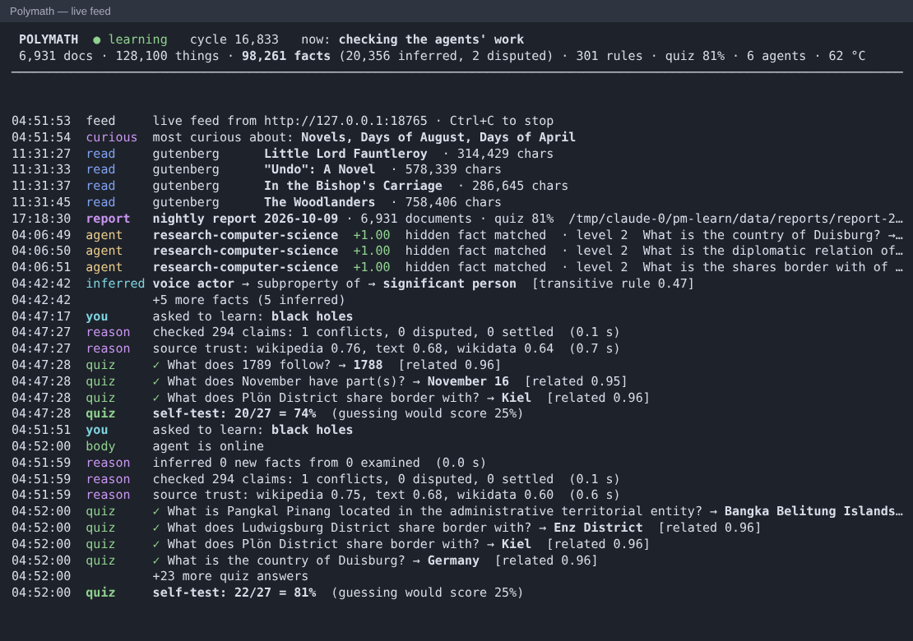

# Verification record

What was measured, on what, and what is still pending. Nothing here is estimated: every number came from
a run of the code in this repository. Unless stated otherwise, the machine was the **development container**:
x86_64, 4 vCPU, Python 3.11, through an HTTPS proxy. That is **not a Raspberry Pi**. Expect the Pi 5 to be
roughly 2–4× slower per core on the numpy-heavy parts.

## Status by phase

| phase | acceptance criterion (from the build spec) | result |
|---|---|---|
| 1 loop | 100 no-op cycles; kill -9 mid-run, restart, effects exactly once | ✅ automated (`test_core.py`), plus a real kill -9 run |
| 2 senses | ≥ 1,000 items from each source over the real internet, license on every item | ✅ see §2 |
| 3 memory | ≥ 10k docs; FTS and graph latency | ✅ synthetic 10k docs (benchmark) and real 7.4k-doc learning copy |
| 4 perception | linker precision ≥ 0.85 on 200 hand-labelled held-out sentences | ✅ 0.856, see §4 (labelled by the AI developer) |
| 5 embeddings | IVF at 1M vectors; SGNS throughput | ✅ see §5 |
| 6 reasoning | rules and inference on real data | ✅ see §6 |
| 7 drive | priorities and bandit on real data | ✅ see §6 |
| 8 evaluation | quiz accuracy above chance on real held-out facts | ✅ see §6 |
| 9 interface | CLI, cited answers, dashboard, /health semantics, live feed | ✅ automated, rendered in Chromium (§7) and in an emulated terminal (§10) |
| 10 body | thermal, disk, backups (the Minecraft player check was removed, §10) | ✅ automated with injected sensors |
| 11 deploy | systemd, live feed terminal at login, idempotent install | ✅ staged install and upgrade, `systemd-analyze verify`; ✅ installed and rebooted on a real Raspberry Pi 4 (§13) |

## 1. Quality bar

- **Tests:** 521 automated tests pass (`pytest`), including:
  - an **offline end-to-end run** of every source through the real agent loop, against a local fixture web server;
  - staged install and uninstall;
  - a real HTTP dashboard server.
- **Coverage:** 94 % of statements and branches (`pytest --cov=polymath`).
- **Lint and types:** `ruff check`, `ruff format --check` and `mypy --strict` (package, tests and scripts) are clean.
- **Purity:**
  - `tests/test_purity.py` imports every runtime module and fails on any third-party import other than numpy.
  - The staged install's venv contains exactly `numpy`, `pip`, `polymath`.

## 2. Real-internet sample (phase 2)

`polymath sample --n 1000` against the live sources, on a fresh database. Every item has license metadata.

| source | items | with license | distinct license strings |
|---|---:|---:|---:|
| wikipedia | 1,000 | 1,000 | 1 |
| wikidata | 1,000 | 1,000 | 1 |
| openalex | 1,000 | 1,000 | 8 |
| pubmed | 1,000 | 1,000 | 1 |
| gutenberg | 1,000 | 1,000 | 1 |
| stackexchange | 1,000 | 1,000 | 2 |
| feed | 2,112 | 2,112 | 7 |
| web (crawler) | 1,000 | 1,000 | 4 |

The crawl ran at ≤ 1 request/s per host, honouring robots.txt. No job ended dead.

## 4. Entity linker on held-out real text (phase 4)

- **Sample.** 200 sentences drawn at random from **non-Wikipedia** documents in the learning copy: feeds, web
  pages, OpenAlex, PubMed, Stack Exchange, Gutenberg. The linker trains on Wikipedia anchors only, so none of
  this text was seen in training.
- **Run.** The trained model, on the real alias automaton, linked every sentence.
- **Labels.** Each of the 362 predicted links was labelled correct or incorrect **by the AI developer (Claude)**,
  not by an independent human annotator. A link counts as correct only if the article is the mention's
  referent in context. Partial spans of a longer name count as wrong; for example, "Woodland" in
  "Woodland Trust".
- **Result.** **Precision 0.856 (310 / 362).**

| source | precision |
|---|---|
| feeds | 0.920 |
| PubMed | 0.927 |
| web | 0.850 |
| Stack Exchange | 0.800 |
| OpenAlex | 0.761 |
| Gutenberg | 1 / 3 |

- **Most common error:** a word inside a longer compound or proper name ("sodium-glucose co-transporter",
  "calcium-channel blockers", "Python Software Foundation"), then generic words ("modulation", "rubric").
- **Data:** `tests/fixtures/linker_eval_200.jsonl`. A test pins the count and precision.
- **Recall** is not measured here. On held-out Wikipedia anchors the linker's own validation gives precision
  0.909 and recall 0.875.

## 5. Benchmarks

`python scripts/benchmark.py --scale full`, development container. See `the benchmark output` for the raw JSON.

| area | measurement | result |
|---|---|---|
| loop | no-op cycle overhead, 20k jobs queued | 2.949 ms (339.1 cycles/s) |
| loop | enqueue | 83,999/s |
| senses | wikitext → clean text | 156.9 pages/s (2.63 MB/s) |
| senses | bz2 block decode (own block reader) vs stdlib stream | 108.52 vs 51.78 MB/s |
| senses | HTML main-text extraction | 3,267.9 pages/s |
| senses | 7z (LZMA) decode | 1,436.5 MB/s |
| memory | index 10,000 docs → 71,147 passages | 465.9 docs/s |
| memory | full-text top-10 | p50 6.93 ms, p95 28.74 ms |
| memory | graph neighbours (top 50), 997,931 triples | p50 0.19 ms, p95 0.36 ms |
| perception | tokenize / sentence split | 4.6 / 4.5 M chars/s |
| perception | Porter stemmer | 148,613 words/s |
| perception | Aho–Corasick, 200,000 patterns | build 0.38 s; 771,371 tokens/s |
| embeddings | SGNS training | 271,176 pairs/s (dim 128) |
| embeddings | IVF, 1,000,000 vectors, 1000 lists | build 10.0 s; top-10 p50 3.56 ms, p95 7.08 ms; recall@10 0.955 |
| reasoning | forward chaining (transitive, 49,999 facts) | 349,616 inferred in 24.35 s (14,360/s) |
| reasoning | truth discovery, 50k facts | 0.72 s |
| drive | PageRank, 2,000,000 nodes / 10,000,000 edges | 1.86 s |
| drive | bandit decision | p50 0.05 ms |
| evaluation | link prediction per quiz question (fixture) | 2.6 ms |
| dashboard | /api/overview, POST /api/ask | p50 1.68 ms, 1.55 ms |
| body | guard observe | p50 0.02 ms |
| body | backup (590.4 MB DB): copy + quick_check + xz | 35.37 s (16.7 MB/s) |

The corpora are synthetic Zipf-distributed text and power-law graphs, so the sizes match the spec. The IVF data is clustered. The container was also running the live Wikidata property read, so treat these as conservative.

## 6. Learning on real data (phases 6–8)

This was run on the **learning copy**: the real phase-2 sample, reprocessed offline by the real agent loop
(`scripts/learn_offline.py --full`), plus the live Wikidata property bootstrap.

| what | result |
|---|---|
| documents read and indexed | 6,931 (443 near-duplicates set aside) |
| entities / aliases | 162,768 / 184,053 |
| sourced facts (Wikidata + infoboxes) | 76,790 (13,266 from infoboxes) |
| Wikidata property records read | 13,315 of 13,930 located; 15,098 of 15,101 predicates named |
| rules learned | 210 inverse, 13 transitive, 6 symmetric (declared by the properties), 41 domain (statistics) |
| facts inferred by forward chaining | 19,917 |
| disputed facts | 1,115 |
| entity linker, Wikipedia-anchor validation | precision 0.909, recall 0.875 |
| **self-quiz on held-out facts** | **22 / 27 = 81.5 %** (95 % Wilson CI 63–92 %), chance 25 %; P(≥ 22 by chance) ≈ 1e-9 |
| quiz answers by deciding evidence | related facts 18/19, embedding 3/4, no evidence 1/4 |
| learned evidence weights (leave-one-out on 100 visible facts) | related 0.61, embedding 0.51, text 0.02, association 0.00, graph 3.0 (prior; a hidden fact never counts directly) |
| calibration fit | log-likelihood −0.57 vs −1.39 for chance; 83 % training accuracy |

**Reading the quiz honestly.**
- **Sample size.** It is only 27 questions. The phase-2 sample holds 1,000 Wikidata items, and only held-out
  facts whose subject *and* answer have names can be asked. On the Pi, reading the full dump makes this grow
  by orders of magnitude.
- **Where the answers come from.** Most correct answers come from *other* facts the agent knows, for example
  an inverse relation or a part-of chain. That is reasoning over its own graph, not text understanding.
- **Before the fix.** The earlier run, before the property bootstrap and the link predictor, scored **12/50 =
  24 %**, which is chance. That run is kept in the database as quiz #1.

**Curiosity on real data.** Topic priorities are non-zero once PageRank precedes them. The top topics were
the Gutenberg bookshelf "Novels" (0.97), "Days of August", "Days of April" (Wikipedia date categories) and
"American Literature". Each one shows its gap × importance × novelty breakdown in `polymath why`.

**Answers on real data** (no network):
- "When was Albert Einstein born?" → 1879-03-14, citing the Wikipedia article.
- "What is the population of Brazil?" → 214,211,951, citing Wikidata.
- "What is the capital of Belgium?" → "Q239 (an entity whose name I have not read yet)". Brussels' record is
  not in the 1,000-item sample, and the agent says so instead of guessing.

## 7. Dashboard in a real browser

- **Render.** Headless Chromium (Playwright) loaded the dashboard against the real learning database, asked a
  question and looked up an entity. The result is the screenshot `docs/img/dashboard.png`.
- **Console.** No errors. The first render found a real bug: the strict CSP blocked inline `style=` attributes
  in chart legends. It was fixed by using CSSOM instead.
- **Phone width.** At 390 px there is no horizontal overflow.

## 8. What was fixed because of these runs

Real data and real browsers found bugs the fixtures did not:

- **Quiz at chance.**
  - Cause: the 1,000-item Wikidata sample contains no property records, so every predicate was a bare `P31`.
  - Fix: the property bootstrap. It read 13,930 property pages located through the multistream index, about
    4 minutes for the index and 85 minutes for the pages.
  - Also: the link predictor with learned weights.
- **Property metadata (inverse, transitive) never became facts.** The rule learner had been tested with
  hand-built triples.
- **Topic priorities all zero.** Priorities were computed before PageRank.
- **The web sample stopped at 982.** Its stop condition counted near-duplicates.
- **`/api/ask` deadlocked.** It took a non-reentrant lock twice.
- **The backup API spun forever.** It ran inside the agent's own write transaction; it now reads through a
  separate connection.
- **`/health` would report a busy agent as dead.** During a long job the database heartbeat cannot commit;
  a heartbeat pulse file now covers it.
- **An answer passage matched "francs" for "France".** A passage must now use the entity's own name.
- **Production defaults would read only 2 GB of Wikidata and have no feeds or seeds.** Fixed.

## 9. Agent society on real data

Six agents were spawned on the learning copy from plain directives:
- "research computer science"
- "predict the country of cities"
- "fact-check borders"
- "watch neural networks"
- "become an expert on Italy"
- "predict administrative regions"

They ran 40 society slices offline. Results after all the fixes below:

| agent | level | XP | verified right / wrong |
|---|---:|---:|---:|
| verify-borders | 3 | 15.0 | 15 / 2 |
| predict-country | 2 | 8.2 | 8 / 2 |
| predict-administrative-regions | 2 | 6.4 | 6 / 1 |
| research-computer-science | 2 | 5.1 | 5 / 0 |
| research-italy | 2 | 5.0 | 5 / 0 |
| watch-neural-networks | 1 | 0.0 | — (nothing new is read offline) |

- **Accuracy.** Together the agents scored **39 verified-correct against 5 wrong answers on hidden facts
  (89 %; chance is 25 %)**, with no false penalties.
- **Learned preferences.** Every agent's arms learned to prefer the action that earned verified rewards.
  Actions with nothing to do in this offline sample (reading, open predictions, disputes) learned slightly
  negative values.

**What the trials found and fixed.** Every round was run on real data until it was clean:

- **The fact-checker lost every dispute verdict.**
  - Cause 1: its verifier compared a choice with *one* hidden copy, but relations such as "shares border
    with" have several true values.
  - Cause 2, upstream in Phase 6: contradiction detection had disputed values that Wikidata itself lists
    together, such as the 23 countries of the English language and the 20 locations of World War II. A
    dispute now needs two sources that disagree, which settled **1,113 of 1,115 disputes** on the learning
    copy and restored those correct facts.
- **Open predictions guessed nonsense** ("the country of ASCII → Germany", "Chicago member of UNASUR").
  - Agents now predict a relation only for subjects whose type usually has it (≥ 30 % of the type).
  - Candidate answers come from what that type's members actually have.
  - Reflexive regularities are learned: the "country" of a country is itself, so China → China and
    Germany → Germany.
- **A watch agent reported old documents.** It now reports only what arrives after it is spawned.
- **"countries" was singularised as "countrie".** Fixed.

**What is not yet measured.**
- Open predictions pay out only when the dumps later deliver the fact, and no new data arrives in an offline
  run, so their accuracy is still unknown. The mechanism is covered by tests: confirmed → +2.0,
  contradicted → −0.8, unsettled after 60 days → expires unrewarded.
- Evolution needs 30 verified outcomes per agent before it forks or judges, so it did not trigger in a
  40-slice trial.

## 10. Live feed terminal; Minecraft player check removed

**Live feed (`polymath feed`).** Run for real against a copy of the learned database (98k facts, 6,931
documents). The real agent loop ran offline jobs: rules, inference, contradictions, source reliability, quiz,
agent steps and verification, priorities. The real dashboard served `/api/feed`. The feed ran in a pseudo-
terminal emulated at 120×36 (pyte, a dev-only tool) and was screenshotted in Chromium:

What the runs showed, and what was fixed because of it:
- **Old quiz phrasing.** The quiz's own template read "What is the capital of of Belgorod?" and "What is the
  follows of 1789?". Questions are now phrased from the predicate label: "What is Belgorod the capital of?",
  "What does 1789 follow?", "What does China share border with?". Per-predicate quiz accuracy no longer
  parses the question text back.
- **Stale header.** The quiz score and rules count in the header lagged up to 2 minutes behind the feed. Small
  tables are now read on every refresh; only full-table counts are cached (60 s).
- **Unhelpful rewards.** Agent rewards did not say what was rewarded; they now show the task (question → answer,
  document, prediction).
- **Layout.** Rule names carried internal ids ("transitive 2774 rule"), the `inferred` tag ran into the text, and
  the header did not fit 120 columns. All three are fixed.

Cost, from `scripts/benchmark.py --only feed --scale full` (1M facts, this container):

| poll | result |
|---|---|
| nothing new | p50 0.08 ms |
| after 5,000 new facts and 50 documents | p50 2.3 ms, p95 3.7 ms |
| first poll, including the full-table counts (repeated once a minute) | 0.30 s |

**Tests.** `tests/test_feed.py` (24 tests) covers:
- events since a cursor, exactly once;
- caps and "+N more" counts, and estimates for huge spans;
- unnamed entities counted, not shown;
- a cursor ahead of the data (restored backup);
- every event kind's rendering, the status header, and ASCII fallback;
- the client loop: waiting and reconnecting, status changes as feed lines, the pinned header's escape
  sequences, terminal restored on Ctrl+C and on resize;
- the HTTP source against the real dashboard, plus error answers;
- the direct source, the CLI, and a registry check that every job kind has a "now:" label.

`tests/test_deploy.py` covers:
- the launcher in lxterminal, foot, xterm and the Debian x-terminal-emulator;
- one window per login (lock), `--new` from the menu, and no terminal installed;
- the in-window prompt if the feed exits;
- a staged upgrade from the dashboard-kiosk autostart: XDG, labwc and wayfire entries are replaced, retired
  settings are commented out with a backup, and a second run is idempotent.

**Minecraft player check removed.** The Server List Ping module, the `yield` on players, the `minecraft_*`
settings and the `vitals.players` column (migration 0012, applied to the real 483 MB database) are gone. An
older configuration still loads, with a warning, and `install.sh` comments those lines out. `yield` remains for
low disk space. The CPU and memory limits stay, to keep the desktop and the feed responsive.

## 11. Storage pool and SD-card mode

**Real block devices.** The real helper (`polymath storage attach/detach`) ran against loop devices in the
development container, with the real `blkid`, `sfdisk`, `mkfs.ext4`, `mount` and `umount`:

| case | result |
|---|---|
| brand-new blank 2 GB device | formatted ext4 `POLYMATH`, mounted under the pool, `polymath-brain/` mode 0750, manifest written; dedicated, 1.92 GB of brain space |
| device with random data and no signature | refused: "holds data Polymath does not recognise; not touching it" |
| FAT drive holding a user's files | the container kernel has no vfat driver, so the mount failed; reported, and the mount folder removed. To verify on the Pi |
| blank partition on a partitioned disk | the container cannot create partition device nodes. To verify on the Pi |
| agent side on the mounted drive | body written to a pack, fsynced, read back identical; downloads and backups placed on the drive |
| unplug (`detach`) | lazy unmount; the agent sees the drive go away, and reads return "unavailable", not an error |

**Tests.**
- `tests/test_storage.py` (26 tests) covers:
  - discovery and pack records: crc, wrong id, missing pack, rollover;
  - spill: least valuable first, unperceived documents stay; reads straight from a drive; passages and updates
    while a drive is away; spill stopping when drives are full; eviction spilling first;
  - retire: bodies back, brain folder removed, never re-adopted; recall without room evicts;
  - placement of downloads and backups; arrival, departure and return events in the feed; the guard asking for
    spills; the CLI;
  - the helper's rules against a fake `blkid`/`lsblk`/`mount`: system disk, internal and virtual devices, swap,
    LUKS, partitioned disks, missing UUID, ignored and retired drives, foreign-owned mounts, too little room,
    mount and format failures, eject and detach.
- `tests/test_deploy.py` covers the udev rule, `polymath-volume@.service`, and a staged `--allow-sd-card`
  install: an SD-sized budget of 2–15 GB, idempotent, and removed by uninstall.

**Bugs found while building it.**
- A logging field named `name` collided with Python's LogRecord. It would have crashed the agent the moment a
  drive was plugged in, with INFO logging on. Renamed, with a regression test.
- The process-wide pool from one configuration could steer placement for another. Placement now uses only the
  pool of its own configuration.

## 12. Open-web learning, the daily digest, learning from mistakes

**The gate, against the real internet** (development container, real HTTP client):

| what | result |
|---|---|
| safety lists | all six downloaded and loaded in 44 s: StevenBlack 157,912, URLhaus 398, UT1 adult 4,592,050, UT1 phishing 240,482, UT1 malware 240,482, UT1 gambling 47,804. About 5.0 M hashes, 88 MB; downloads deleted afterwards |
| nasa.gov, nih.gov | approved (heavily cited, valid HTTPS, robots.txt allows) |
| smithsonianmag.com | probation (20 citations) |
| pornhub.com / bet365.com | refused: on UT1 adult / UT1 gambling; **never contacted** |
| self-signed / expired / wrong-host / untrusted-root certificates (badssl.com) | refused: "no valid HTTPS certificate" |
| a valid certificate on the same test site | approved |

**Tests.**
- `tests/test_openweb.py` (21 tests):
  - citation counting; list loading (hosts files, plain lists, UT1 archives in slices, reload replacing a list);
    subdomain blocking; unsafe names;
  - the gate failing closed until the lists load, and every verdict (blocklist, name, certificate, private
    address, unreachable then retried, robots, redirect away), with refused sites never contacted;
  - the daily cap and the probation quota; trust judging (a site contradicting Wikidata dropped, an agreeing one
    approved);
  - mistakes read about, re-tested, fixed or given up after 3 tries; agents' mistakes collected; the digest
    content, its feed lines, the CLI and the dashboard.
- The offline end-to-end test now downloads and loads a safety list through the real agent loop, and checks that
  Wikipedia articles record the sites they cite.

**Bugs these tests caught.**
- A newly approved site stayed blocked for up to a minute, because the crawler refreshed before the verdict was
  saved.
- Single-valued relations were judged from all facts, so a lying site's own claims could make a relation look
  multi-valued and dodge the check. They are now judged from Wikidata only.
- The "offline" end-to-end test started downloading the real safety lists; tests now use local lists only.

## 12b. Feed face and version badge

- Rendered in a real pseudo-terminal (120 columns, emulated with pyte) for every mood. That is the image in
  OPERATIONS §"The live feed". The badge stays whole on the right while long activity text is shortened.
- Every face glyph was checked against the cmap of DejaVu Sans Mono, the Raspberry Pi OS terminal font
  (`tests/test_face.py`). All of them are present and none is double-width.
- `tests/test_face.py` (34 tests) covers:
  - reading `build.json` and `.git` (loose, packed, detached and worktree refs);
  - the heartbeat carrying the build, and `polymath version` / `status` / `--version`;
  - badge states, header layout, and milestones;
  - mood per job kind, reaction timing and priority, and the animation (scanning eyes, spinner, thought dots,
    blink, constant width);
  - the feed redrawing between polls and reloading into a new installed build (but not for a development
    checkout);
  - `install.sh` writing the stamp once.
- Not yet seen on the Pi itself: the font check used the same DejaVu Sans Mono that Raspberry Pi OS ships.

## 12c. SD card guard, the brain's home, tell, predictions, surprise, recap, map, live page (v0.3.0)

**Writes per cycle.** `/proc/self/io` `write_bytes` for 1,500 cycles each, against the previous version on the
same database:

| cycle | before | after |
|---|---|---|
| idle (nothing to do, every 2 s) | 4.2 kB | 0 kB (heartbeat only on change or every 30 s) |
| a job slice (no-op job) | 103.5 kB | 77.1 kB (−25 %: busy heartbeat every 10 s, redundant `jobs_kind` index dropped) |

An idle agent used to write about 360 MB a day just for its heartbeat. Raising `wal_autocheckpoint` from 1,000
to 4,000 pages changed little (−1.5 %); it is kept at 4,000. A real day's total on the Pi will come from
`polymath wear`.

**Moving the brain onto a drive.** Tested with a fake `blkid`/`lsblk`/`mount`/`systemctl` (`tests/test_wear.py`):
- a blank SSD is formatted, then the agent is stopped and the data copied and verified (file count, bytes,
  SQLite `quick_check`, and the copied database still holds events written before the move);
- the SD copy is moved aside, the marker is left, the drive is bind-mounted and the agent started;
- boot re-mounts the brain, unplugging stops the agent, and eject refuses while the agent runs;
- a failed copy or a corrupt database copy leaves the brain on the SD card;
- shared, small, Windows-formatted, and NVMe-already cases do not move;
- `storage format` refuses a drive with files unless `--erase-files`, and always refuses one holding spilled
  documents.
- (v0.4.1) a fresh exFAT shop SSD with the maker's installers on it is formatted and becomes the brain's home;
  then the same drive is never formatted again: not on replug, not after a failed (power-cut) format, and not
  after a laptop reformat to an empty exFAT. Every not-fresh case is left alone: a file or folder of yours, a
  plain text file, Polymath's documents, a retired drive, under 32 GB, more than 1 GB of "maker" files, a drive
  with no serial or model, or the setting off.
- (v0.4.2) drive faces and the 12-hour clock: rendered in an emulated 118×14 terminal (pyte, DejaVu Sans Mono)
  with the brain-moved face in the header and times such as ` 9:04:10 PM` lined up; every face glyph is checked
  against the Pi's terminal font by `tests/test_face.py`.
- (v0.4.3) the feed on the Pi's small touchscreen (a user photo: about 72 columns, a dark blue background) cut
  off the header and showed the blue "read" tag almost invisibly. Rendered again at 72 columns on a dark blue
  background: the header fits, messages wrap, and "read" is bright blue (`docs/img/feed-small-screen.png`).

**Not yet done on real hardware.**

**Tell.** On the earlier real learning copy (97,822 facts):

| entity | its paragraph |
|---|---|
| Portugal | "Portugal is a country in Southwestern Europe. Its capital is Lisbon. Its official language is Portuguese. It has a population of about 10.3 million. It covers 92,225 km². It was founded on 25 July 1139…" |
| Albrecht Dürer | "Dürer was born in Free Imperial City of Nuremberg on 21 May 1471 and died … on 6 April 1528…" |

Problems found by reading real output, and fixed before shipping:
- units printed as ids ("Q712226");
- codes and identifiers shown as facts;
- "a"/"the" errors;
- people not recognised because the class "human" had not been read yet.

**Predictions.** A backtest on the same copy hid real single-valued facts from every evidence source and let the
predictor guess among the relation's usual answers. It got **25 of 27 right, against 23 % chance**, and abstained
on 33 where no evidence spoke. Earlier runs, with junk relations still included, gave 20/32 and 8/17, so it
depends on the relation mix. On the copy's real gaps it made no guesses: there was no evidence, and it does not
guess blind. The Pi's much larger graph is where it will be measured.

**Did you know.**
- Speed: 300 new facts per run in 0–4 s, after capping hidden-fact predictions at 40 per run (the first
  version took over a minute).
- Problems found by reading real output, and fixed:
  - many-valued relations (borders, diplomatic relations) produced nonsense surprises;
  - areas were compared across units;
  - series values were repeated;
  - Wikidata's own bookkeeping entities appeared.
- What it says now: "Sierra Leone has the smallest life expectancy of the 33 similar things it knows: 51.84
  years."

**Knowledge map.** 120 topics, 339 edges and 19 clusters on the real copy, in 0.5–0.8 s. Literature, medicine
and studies of people, science, and neural networks form visible clusters.

**Dashboard and live page.** Rendered in headless Chromium against the real copy: no console errors.
- the map, with hover and click-to-ask: `docs/img/knowledge-map.png`;
- "Tell me about Germany" in the ask box;
- the week in review and the predictions panels: `docs/img/dashboard-panels.png`;
- `/live` on a 390-pixel phone viewport: `docs/img/live-phone.png`.

## 12d. Self-improvement (v0.4.0)

Run on a copy of the same real learning database (97,822 facts; 141 transitive, inverse and symmetric rules; 2 self-tests with 77 answers).
The first version ran on it and showed four problems; each was fixed and the run repeated.

| part | first version on real data | after the fix |
|---|---|---|
| self-tuning | one trial ran 130 s, 112 s and 42 s in a single slice, starving every other job | trials run in normal slices (5 s budget: longest slice 6.6 s; 7–19 slices), resumable from JSON checkpoints |
| link-predictor settings | gain exactly 0: the combiner gives the association clue weight 0, so no setting of it could show | judged on the association clue itself: 0.3–0.4 s per trial. It found the clue badly overconfident (log-likelihood −8.6 against −1.39 for chance) and adopted **`link.features` 40 → 20** (−8.24 → −7.43 on 60 questions), now under watch |
| rule trust | "participant in ↔ participant" demoted, 8 of 8 "refuted", because sparse data made "participant" look single-valued | strict single-value test (≥ 50 subjects, ≥ 95 % one value): not demoted. 1 conclusion withdrawn ("drug or therapy used for treatment → inverse property → therapeutic area") |
| withdrawn conclusions | would be re-derived by the next inference pass | remembered in `withdrawn`: a full re-run of inference from cursor 0 (34,704 facts, 604 new conclusions, 0.9 s) re-derived **0** of them |
| reading strategy | papers, books, Q&A, feeds and the web all at weight 0.5: they add few facts and the median was 0 | value counts documents linked to known things (½ point each), median over sources that taught anything: OpenAlex 0.98, PubMed 1.04, Gutenberg 0.98, Stack Exchange 1.0, feeds 0.95, web 1.0; Wikipedia and Wikidata 2 |

Also on this copy:
- `link.subjects` 400 vs 200 scored identically: on this graph no object has enough subjects for the limit to
  bind. `predict.min_confidence` 0.3 vs 0.4 also tied: no guess falls between them. Both trials were correctly
  rejected and not shown in the feed.
- No specialist was spawned: overall accuracy 44 %, and no relation had ≥ 12 answers in 14 days below the bar.
  Spawning, retiring and the cool-down are covered by tests only.
- Phrasing learned one sentence form, "X was born in Y" (birth place); the pattern table of this copy is small.
- Germany still reads "capital Bonn (worked out by reasoning)": the contradicting fact (Berlin) is a hidden quiz
  fact here, and hidden facts never count against a rule, by design.
- Rule audit: 141 rules in 1.8–2.4 s.
- Dashboard panel rendered in headless Chromium at 1280 and 390 px (`docs/img/self-improvement.png`).

## 12e. Reasoning skills and cleaner knowledge (v0.5.0)

Run on a copy of the real learning database (97,822 facts, 93,677 sentence pairs read). That copy holds Wikidata
facts for a few hundred things only (410 coordinates, 174 birth dates, 317 areas), so questions were asked about
things it has facts for. Answers, as returned (times on the development container):

| question | answer |
|---|---|
| Is Brazil bigger than Angola? | Yes. Brazil (8,515,767 km²) is bigger than Angola (1,246,700 km²), by 7,269,067 km² (85%); compared by area. |
| How many times bigger is Brazil than Portugal? | Brazil is about 92.3 times the area of Portugal (8,515,767 km² against 92,225 km²). |
| What is the population density of Portugal? | About 112 people per km² (291 per sq mi): a population of 10,347,892 on 92,225 km². |
| Is Lisbon higher than Helsinki? | Yes. Lisbon (100 m) is higher than Helsinki (17 m), by 83 m (83%); compared by elevation above sea level. |
| How far is Germany from Portugal? | about 2,028 km (1,260 miles) apart, as the crow flies |
| Which is further north, Portugal or Angola? | Portugal (latitude 38.70° N against 12.35° S) |
| How old was Albrecht Dürer when he died? | died at about 56 (born 21 May 1471, died 6 April 1528) |
| Who was alive at the same time as Albrecht Dürer? | Nicolaus Copernicus (1473–1543), Andrea del Sarto (1486–1530), … (0.24 s) |
| Which came first, Plato or George Washington? | Plato: date of birth 428 BC, about 2,160 years before George Washington |
| Who is the head of government of the capital of Portugal? | The capital of Portugal is Lisbon. The head of government of Lisbon is Q9697231 (a name not read yet). |
| What caused World War II? | I know 18 causes of World War II, but have not read their names yet. |

Problems the first version showed on this copy, all fixed before release:
- **Wrong thing of several with one name** ("Paris (mythology)", "Penguin Books"): names now resolve to the thing that
  has the facts the question needs, then the best-known.
- **A bad merge** ("Poseidon" into Neptune through an alias): only a name or article title counts now; 66 merges
  dropped to 10 ("Olympic games" into Olympic Games, "Fungi" into fungi …).
- **Noisy causes and kinds** ("algorithm causes logic", "acid is a proton", "Huxley is an English"): weak cues removed,
  the second thing must end its noun phrase, people are not given kinds, and a claim needs two sentences before it is
  used. 31 causes from the copy's sentences dropped to 20 stored, none used until confirmed by a second sentence.
- **Raw ids and dates**: kinds and causes known only by id are counted, not printed ("Q17444909"); dates read "428 BC"
  and "21 May 1471" everywhere answers show them.
- **Impossible facts** on the copy: 3, all between two Wikidata facts and therefore only noted ("Quintus Curtius Rufus:
  died 50 before being born 100", a circa date; "Chilean Antarctic Territory is bigger than Chile").
- **Dated facts** need Wikidata to be read again: this copy (and your Pi's current graph) was read before start and end
  times were kept, so "the capital of Germany is Bonn" remains until the next monthly Wikidata dump is read.

Tables, the second language, how-to steps and the end-to-end Spanish pipeline are covered by tests with synthetic
articles and answers; the copy holds no table data, Spanish articles or answers with steps (all are read from new
documents).

## 12f. Always on (v0.5.1)

**Development container (x86_64, Python 3.11).** 556 tests pass at 94 % coverage; ruff, ruff format and mypy
--strict are clean. New: `tests/test_always_on.py` (36 tests).

**The reported symptom, reproduced.** The Pi's feed stayed on "waiting: no answer from http://127.0.0.1:8765".
- **Setup:** v0.5.0 (`7f29c9f`) against a 5,000,000-fact, 876 MB brain, asking for `/api/overview` and
  `/api/feed` at the same moment, as the phone page and the desktop feed do.
- **Old code:** the feed got its answer after **5.75 s**. The feed gives up after 5 s, so it showed "no
  answer". The cause: every request shared one locked connection, and the full-table counts took 1.3 s even on
  this fast CPU.
- **Expected on the Pi** (not measured): about 4–6× slower per core, the dashboard capped at 25 % of one core,
  and the file read over USB 2. The wait would be tens of seconds.
- **v0.5.1:** the feed got its answer in **0.05 s** in the same test.

**Real-process drills** (a real `polymath run` and `polymath dashboard`, a relay in front of the proxy that can be
"unplugged"):

| drill | result |
|---|---|
| internet unplugged | offline within 1 s: two downloads refused. Both were deferred with 0 attempts used; 0 dead jobs; 0 network jobs ran while offline. All 19 study kinds ran; the probe ran and found nothing |
| internet back | the probe 2 min later answered: "back online after 3 min: reading again". It then loaded the safety lists and read 567 Wikipedia articles |
| dashboard under a fake systemd notify socket (`WATCHDOG_USEC=2 s`) | `READY=1`, then 23 watchdog pings in 12 s |
| dashboard frozen (SIGSTOP), feed as an unprivileged user who cannot read the database | the feed switched to the agent's snapshot within 5 s ("no answer from …: showing the agent's own snapshot instead · fix: sudo systemctl restart polymath-dashboard") and showed the offline and online events and the reading |
| `polymath doctor` as that user | all ✓ with the dashboard up; with it frozen: "✗ dashboard no answer … within 6 s (hung or overloaded) → sudo systemctl restart polymath-dashboard", exit 1 |

**Found and fixed during the drills:**
- `Path.exists()` raises PermissionError on a directory you may not read (Python 3.11–3.13). `doctor` crashed
  for the desktop user and now reports "its files belong to the polymath user".
- The agent's snapshot showed "counting…" for good. It now carries approximate counts (the highest row numbers,
  shown with "~").

## 12g. The brain's drive missing (v0.5.2)

**What the Pi showed after v0.5.1** (photo): "waiting: no answer from http://127.0.0.1:8765; the database
directly: cannot read the database: PermissionError; the agent's own snapshot: no agent…". Neither the agent
nor the dashboard was running. Two causes in the code were found and fixed:
- **A drive drop-out switched everything off.** When the brain's drive leaves the USB bus, even briefly,
  `detach` stopped both services, and nothing started them again until the drive was attached once more.
- **The dashboard could not start without the brain.** Its unit's `ReadWritePaths=/srv/polymath/db` did not
  exist while the drive was missing, so systemd refused to start it. The agent's `init` failed on the missing
  drive too, so it never got to wait.

**Confirmed on the Pi** (`systemctl status`, 2026-10-12):
- `polymath`: `ExecStartPre … polymath init (code=exited, status=3)`, the missing-drive refusal, in a restart
  loop;
- `polymath-dashboard`: `status=226/NAMESPACE`, the missing `/srv/polymath/db`;
- `lsblk` showed `sda 0B usb`. The SSD's USB bridge enumerates but the drive behind it reports 0 bytes, which
  points to power, a brown-out or the cable.

v0.5.3 detects that exact state (`body/sensors.unresponsive_usb_disks`, from `/sys/block/sd*/size` and the USB
device path) and names it in `polymath doctor` and in the waiting message, with the fix.

**Live drill** (real `polymath init`, `run` and `dashboard`; the data directory holds only
`MOVED-TO-DRIVE.json`, as after a drop-out):

| step | result |
|---|---|
| `polymath init` | exit 0: `{"waiting": "the brain lives on the drive Samsung T7, which is not plugged in …"}` |
| `/health` | 503 "database unavailable: the brain's drive is not mounted: plug it in (Polymath starts by itself)" |
| the feed, through the dashboard and through the snapshot | "● paused · NOW paused — the brain lives on the drive Samsung T7, which is not plugged in …" |
| drive "plugged in" (marker removed) | the agent started 4 s later by itself; the feed showed "learning" and a `problem` line: "the brain's storage was missing for 15 s before this start" |

The 564 tests pass; ruff, ruff format and mypy --strict are clean.

## 12h. A dead brain mount after a USB reset (v0.5.4)

**What happened on the Pi:**
- `sudo usbreset 31db:9210` brought the SSD back (`lsblk` showed its full size).
- The installer then failed with "changing ownership of '/srv/polymath': Input/output error".
- `polymath doctor` showed the agent down and "the dashboard cannot open the database", while the drive itself
  was mounted again.

**Why:** the frozen SSD never left the bus, so `detach` never ran. After the reset it came back as a new
device and was mounted again, but `/srv/polymath` stayed bound to the dead connection, and `mount_home` trusted
it ("already mounted").

**Fixed:**
- `mount_home` checks that the existing brain mount answers and comes from the drive that is there now;
  otherwise it stops the services, drops the dead mount and binds the live drive.
- `check_storage` turns a dead-mount error (EIO, ENOTCONN, ESTALE, ENODEV, ENXIO) into `BrainDriveMissing`, so the
  agent waits visibly.
- A disk I/O error under a running agent stops it, with no retries spent, so systemd restarts it into waiting.
- `doctor` names a dead mount and says `sudo reboot`.
- `install.sh` warns and carries on instead of aborting.

Tests: `test_a_dead_brain_mount_is_replaced_not_trusted`, `test_a_dead_mount_counts_as_a_missing_drive`,
`test_storage_lost_mid_run_stops_the_agent_for_a_clean_restart`, `test_doctor_names_a_dead_mount`,
`test_installer_carries_on_past_a_dead_brain_mount`.

## 12i. Bringing the drive back by itself (v0.5.5)

**What the Pi showed:** the SSD sits in a DockCase enclosure, whose capacitor gives it a safe power-off. On a
reboot the enclosure does not power-cycle, and afterwards the drive was missing or showed `sda 0B usb` until it
was replugged.

**Added: `body/heal.py`** (`polymath storage heal`, every minute from `polymath-heal.timer`):
- brain states `healthy`, `local`, `missing` and `dead`;
- a dead mount is dropped and the drive is retriggered;
- a soft USB reset (the sysfs `authorized` switch of the device the 0-byte disk hangs off), at most every 2 min;
- a USB power cut with `uhubctl` (Pi 4 hubs `2` and `1-1`, 20 s off) after 90 s missing, at most every 15 min and 6
  a day;
- its record goes to `/var/lib/polymath/heal.json` and `/run/polymath/heal.json`. The agent reports each action
  to the caretaker's inbox when it starts, and `doctor` shows the last 24 h.

**Also fixed:** a 0-byte device was "blank" by an empty read. It is now skipped outright and never formatted.

Tests: `tests/test_heal.py` (9) and `test_a_drive_reporting_zero_bytes_is_never_formatted`. On the Pi, the
power cut itself is not yet measured (uhubctl on the Pi 4's VL805 hub).

## 12j. A frozen drive never freezes Polymath (v0.5.7)

**What the Pi showed:** after installing v0.5.6, `Job for polymath.service failed because a timeout was
exceeded`, and the dashboard was not listening. The brain's mount no longer failed with an I/O error; it did not
answer at all. Every `stat` or `read` on it slept in the kernel, so `polymath init`, the dashboard's database
open and the self-heal's own check all froze.

**Added: `core/fsprobe.py`.** `probe(path)` asks in a tiny child process and waits at most a few seconds. It
answers `ok`, `missing`, `denied`, `dead` (I/O error) or `hang` (no answer). It uses a process, not a thread: a
task stuck in the kernel cannot be killed, so a stuck thread would keep `polymath init` from exiting. A probe
still stuck from earlier makes the next one for that path answer `hang` at once. If no process can start, a
thread asks instead.

**Every place that looked at the brain's storage now asks through it:**
- the agent's storage check (data directory, home marker, database, moved marker: a frozen drive is
  `BrainDriveMissing`, so `init` passes and `run` waits visibly);
- the dashboard (opening the database, and the 503 reason);
- `doctor`;
- `storage heal`'s brain state;
- the volume helper (`_answers` for the brain's mount; it never moves the brain while its storage does not
  answer).

**The self-heal no longer waits on anything frozen:**
- it lazily unmounts first;
- it releases each drive under `/mnt/polymath` whose own mount is dead or frozen, and resets its USB device (the
  reset makes stuck I/O fail, so hung processes exit);
- only then does it restart the services, and the drive units, with `--no-block`.

The volume helper's "replace a dead brain mount" stops the services with `--no-block` too.

**Installer:** `install.sh` runs `chown` and `chmod` on the data directory through `bounded`, which gives up after
15 s and leaves the stuck command behind, so the code and the services still update.

**systemd:** `polymath.service` now has `WorkingDirectory=/`. Before, systemd would enter the data directory, and
on a frozen mount it hung there before Polymath even started.

Tests: `tests/test_fsprobe.py` (15). A FIFO with no writer blocks exactly like a frozen mount. It is used to
freeze the probe, `check_storage`, `polymath init` and the volume helper for real. `/proc/self/mem` gives a real
EIO. A child Python process shows that a stuck probe never keeps a program from exiting. On the Pi, recovery from
a real frozen DockCase is not yet confirmed.

## 12k. Learning without its drive: the standby brain (v0.6.0)

**Why:** a Pi 4 with a bus-powered USB enclosure can lose its SSD for hours (power, the enclosure's safe-off
state, a UAS freeze). Waiting visibly was not enough: Polymath should keep working.

**Added: `core/standby.py`.**
- After `standby_after_s` (300 s) of waiting, `polymath run` starts a small standby brain on the SD card
  (`/var/lib/polymath/standby`, systemd `StateDirectory`, 0750, owned by the agent).
- In standby it does light reading only: dumps, backups and the drive pool are left out. Its budget is 3 GB, it
  keeps 2 GB free for the system, and the SD card wear guard is on.
- A watcher looks for the real brain every 30 s and exits 75 when it answers. A restart while the drive is still
  gone resumes the same standby brain.
- On the real brain, `storage.fold_standby` folds it in. It is resumable (checkpoint per batch of 50 documents)
  and idempotent (documents through `DocumentStore.add`; standby id in kv `standby_folded`). It only adds.
- Feed, face, `doctor` and the caretaker's inbox show it.

**Found on the way, fixed:** `load_config` read `home-drive.json` on the brain's drive with no time limit. On a
frozen drive that hung every command (`init`, `run`, `dashboard`, `doctor`) before any of the v0.5.7 probes ran.
It now asks through `core/fsprobe` first.

Tests: `tests/test_standby.py` (18), with real agents for the whole story: drive gone, `polymath run` on
standby, drive back within the watcher's interval (exit 75), fold (documents, Wikidata, crawl progress, issues;
nothing doubled; the standby brain removed), a fold split over slices, a restart that resumes standby, and the
feed, face and doctor lines. On the Pi this is not yet run.

## 12l. The caretaker knows every problem and its fix, and stays current (v0.6.1)

**Why:** Christian asked that the caretaker be told about every problem and every update, so it can fix the
same problem by itself next time.

**Added:**
- **`polymath/agents/faults.toml`**, the caretaker's knowledge:
  - 20 known faults, one for each issue code Polymath reports and each problem seen on the Pi;
  - the situation on the Pi now;
  - 7 incidents from the Pi's history;
  - one `[[update]]` per release since v0.5.1.
- **`agents/faults.py`** loads and validates it, and matches problems by code or by their words.
- **`core/issues.report`** tags each problem with the faults it matches.
- **`polymath doctor`** gives the known fix on its problems line.
- **`polymath caretaker`** gives the briefing; `known`, `show <id>`, `history` and `--json` list the rest.
- **`polymath/CLAUDE.md`** states the update rule for every future change.
- **`docs/CARETAKER.md`** is the caretaker spec, now in the repository, with a new section C.6b.

**Tests:** `tests/test_faults.py` (21). They are the rule itself; each of these fails the suite:
- a version bump without `updated_for` and an `[[update]]` entry;
- an `issues.report` code in the source that no fault matches (scanned);
- history fixed in a future version;
- a step that changes the system (`/boot`, apt, dpkg, chmod, …) without `needs = "approval"`;
- a fault that tells nobody what to do. The first run caught this one: the standby fault had only an `auto`
  step.

Malformed knowledge is refused: unknown `needs`, duplicate ids, priors that do not add up to 1, unknown fault
references.

## 12m. What the Pi itself showed, fixed (v0.6.2)

**Seen on 2026-10-14 through a Remote Control session on the Pi (read-only diagnostics):**
- **None of v0.5.7–v0.6.1 was ever installed.** `/opt/polymath` ran v0.5.6 (build `ca43ce6`), because
  `~/Blazeffect83` was checked out on `claude/aegis-agent`, another project with local uncommitted work. So
  `git pull` never fetched Polymath.
- **The SSD was frozen at USB 2 speed:** 480M, the `usb-storage` driver, behind the USB 2 hub. The kernel's
  `usb-storage` thread and `polymath init` were in state D.
- **`init` timed out;** every restart after that failed with `database is locked`, because the stuck process
  held the lock. Power was fine (`throttled=0x0`).

**Fixed:**
- **Probes read past the page cache** (`fsprobe.probe(direct=True)`, `O_DIRECT`). A frozen drive whose data is
  still cached is now caught; where the filesystem has no `O_DIRECT`, it falls back to an ordinary read.
- **`app.open_brain`:** a database that stays locked, or a disk I/O error on opening it, now means
  `BrainDriveMissing`. Polymath waits and then switches to the standby brain instead of crash-looping. Used by
  `init`, `run` and every command.
- **`doctor`** names a USB disk linked below USB 3 (`sensors.slow_usb_disks`, read from sysfs `speed`), with the
  fix: a blue port, a USB 3 cable, no USB 2 hub.
- **The caretaker's knowledge:**
  - new faults `update-not-installed` (the fix: a separate `git worktree`, never touching the other checkout)
    and `brain-drive-usb2`;
  - the situation as seen on the Pi;
  - two new incidents.

Tests: `tests/test_pi_1014.py` (8). On the Pi this is not yet installed.

## 12n. One command to recover and install: `scripts/rescue.sh` (v0.6.3)

**Why:** after v0.6.2, Christian ran the manual recovery-and-install block, and "nothing changed". `build.json`
still said 0.5.6, the agent stayed `activating` and the dashboard hung. Nobody could see where it stopped.

**Added:** `scripts/rescue.sh`, which runs six steps, each with a time limit and a ✓, – or ✗ line:
1. versions;
2. stop the services without waiting;
3. free a frozen brain drive:
   - stuck processes seen 3 times a second apart, or a direct read with no answer within 10 s;
   - lazy unmounts of everything listed in mountinfo;
   - a USB reset through sysfs `authorized`;
   - waiting for the stuck processes to end, then for the drive to be mounted again;
4. `dpkg --configure -a` and `uhubctl`;
5. `install.sh` (its output shown live);
6. the installed version, the services, `polymath doctor`.

There is a summary at the end. The log is in `/var/log/polymath-rescue.log` and `~/polymath-rescue.txt`, and the
exit status is 1 if any step failed.

**install.sh:**
- a failed step names its line and command (ERR trap);
- the services restart with `--no-block`;
- mounts are read from `/proc/self/mountinfo` (`mountpoint` stats a frozen mount);
- a banner names the version being installed and the version installed now.

**Tests:** `tests/test_rescue.py` (7). The real script runs against stand-in commands, a fake sysfs USB tree and
a fake mountinfo in five scenarios:
- frozen, seen by stuck processes;
- frozen, seen only by the direct read;
- healthy (nothing unmounted or reset);
- the install fails (✗ and its last lines);
- the drive does not come back (✗ and the standby note).

Two more tests check that the root guard comes before any action, and the installer properties above.

While I wrote these tests, a check that ran *after* the root guard executed the real script once inside the
development container, which runs as root. Everything it created there (the `polymath` user, `/opt/polymath`,
two packages) was removed. The test now checks the order without running the script as root. On the Pi this is
not yet run.

## 12o. SD-card mode: the whole brain on the SD card (v0.7.0)

**Why:** the SSD still freezes on its USB 2 link. On 2026-10-15 Christian asked to run the agent and everything
else off the SD card until the SSD is solved: about 15 GB of room instead of 1 TB.

**Added:**
- **configuration drop-ins**: `/etc/polymath/polymath.d/*.toml`, merged after `polymath.toml` in name order;
- **`storage.sd_only`** (`config.apply_sd_only`):
  - the brain moves to `storage.sd_dir` (`/var/lib/polymath/brain`, a systemd state directory);
  - nothing touches a drive: no adoption, no formatting, no move or mount of the brain's drive, no heal, no standby,
    and the pool sees no drives;
  - the budget is the brain's bytes plus the card's free space, less `sd_keep_free_gb` (2 GB);
  - two backups are kept, and every job kind runs;
- **`core/sdcard.py`**: the marker (with `fold_after`), kv `sd_card` for the feed and the dashboard, the issue
  `storage/sd_card`, and the snapshot status;
- **folding back** (`core/standby.py`): the planner and `fold_job` handle *away* brains, the standby brain and the
  SD-card brain. From the SD-card brain they take only what is new: documents after `fold_after`, and Wikidata
  records, crawled pages, issues and the agents Christian set up since `started`;
- **what you see**: the feed shows `learning on the SD card` and an SD-card note on the NOW line; doctor shows an
  `sd card` line and `drives: none used`; heal reports `sd-card` without probing anything;
- **`scripts/sd-card-mode.sh on|off|status`**, with `scripts/ops-lib.sh` shared with `rescue.sh`. In SD-card mode,
  `rescue.sh` lets go of a stuck drive and keeps its USB device off, instead of waiting for it to come back;
- **`install.sh`**: in SD-card mode it never touches `/srv/polymath` or edits `polymath.toml`;
- **the units**: `StateDirectory=polymath/standby polymath/brain`, and the dashboard may write next to the
  SD-card database;
- **the caretaker's knowledge**: v0.7.0, the faults `sd-card-mode` and `sd-card-mode-switch`, updated remedies, the
  situation and the history.

**Tests:**
- `tests/test_sdcard.py` (16):
  - drop-ins: order, typos refused, `.off` files ignored;
  - every SD-card setting and its limits, and the budget arithmetic with a faked `disk_usage`;
  - every job kind registered;
  - heal and attach touch nothing (any probe fails the test);
  - `polymath run` marks the brain and reports to the caretaker;
  - folding: only what is new, never into itself, a done fold only clears; agents set up on the SD card come
    back (by directive, name and status), evolved ones stay behind;
  - a full cycle with real agents: SSD brain, then SD-card mode, then back, with the pages learned on the SD card
    now on the SSD;
  - the feed, the dashboard's feed status and doctor;
  - the units, and a staged `install.sh` in SD-card mode.
- `tests/test_sd_card_mode.py` (14): the real script against stand-in commands (systemctl, umount, udevadm, ps),
  a fake sysfs USB tree, a fake mountinfo and temporary directories for everything it writes:
  - `on` with a frozen SSD: lazy unmount, USB device off, the old copy checked and renamed into place, install,
    the agent on the SD card;
  - `on` with a healthy SSD: a clean unmount;
  - `--fresh` with `--keep-ssd-on`;
  - a damaged copy: kept, not used;
  - a copy on another filesystem: never copied;
  - running `on` again after a reboot;
  - an agent that does not report the SD card, and one still starting (a big brain: up to 5 min);
  - a failed install;
  - `off` with the SSD back;
  - `off` with the SSD still gone, so SD-card mode stays on;
  - `status` without sudo;
  - the root guard comes before any action, and nothing formats or deletes.
- `tests/test_rescue.py` (+2): SD-card mode in the rescue.

The newer `mypy` (2.4) in the development container flagged 18 typing slips in older tests; they are fixed.

**Result (development container, x86_64, Python 3.11):** 681 tests pass and 1 is skipped, at 94 % coverage
(pytest exit 0). `ruff`, `ruff format` and `mypy --strict` (package, tests, scripts) are clean, and ShellCheck 0.11
reports no warnings on the three scripts.

**Rehearsal of the upgrade path:** brains built by the real v0.5.0 and v0.5.6 code (git worktrees of those
commits) were renamed into place as the script does, then started in SD-card mode by the v0.7.0 CLI
(`polymath init`, `polymath run --until-idle`, `polymath doctor`). Both are schema 17 like v0.7.0, so no
migration was needed. Their documents and agents were kept, the marker's `fold_after` was their newest document,
and the room was sized to the free space (2 GB kept free). Adoption and heal were off, and the inbox had the
SD-card note.

**Not yet run on the Pi.** The script has only run against stand-ins here.

## 12p. Orin the Caretaker (v0.8.0)

**Why:** Christian asked for an agent "dedicated just for fixing and working on the pi or the polymath intelligence
… troubleshooting, security, and any simple to advanced issues it can handle", and moved forward with it on
2026-10-15.

**Built** (docs/CARETAKER.md C.1–C.10):
- `agents/caretaker.py`: the senses, learned bands, incidents, Bayes and value-of-information checks, ten Tier 1
  remedies with their bounds, verification and learning (`fault_stats`), escalation with the four parts, inbox
  triage, and the install and security watch;
- migration 0018;
- the loop, guard, feed, face, doctor, snapshot and CLI hooks;
- ten new known faults, `[situation] on_hold`, and `selftune.reset(by=…)`.

**Tests:** `tests/test_caretaker.py` (26), the C.10 list:
- detection: a blip opens nothing, a broken streak opens nothing, a lasting symptom opens one incident with its
  evidence, and a hard limit opens one at once;
- Bayes against a hand computation; value of information choosing the telling check (never a coin toss); every
  model complete and known to `faults.toml`;
- heat: checked, slowed down, verified, learned, back to full speed;
- a failed remedy escalates with all four parts, quoting the fault's step; escalations repeat at most daily;
- a self-resolving symptom makes Orin less jumpy;
- dead jobs: requeued once for a passing problem, told (not retried) for a bug;
- crash loops: quarantined, never core kinds, never more than three; the real loop holds a quarantined kind back
  and runs a requested checkpoint; the guard obeys the slowdown, and Orin runs in a pause;
- every reported problem reaches it: a new one is escalated as "new to me", SD-card mode (on hold) is noted only,
  and quiet ones close after a day;
- the build, configuration and permissions are watched; in SD-card mode the SSD's USB speed is not raised;
- safety: an AST scan finds no subprocess, socket or ctypes imports, and no file, permission or process calls; no
  allow-list or vetting names appear in its source; malformed kv switches never break the loop;
- end to end, a real agent at 74 °C: Orin's job opens the heat incident and slows it down. The snapshot, the face
  (`mending`), doctor, the feed's `Orin` line, `polymath caretaker` and the incident list show it.

Other test files changed for the new behaviour: `test_body` (Orin is allowed during a pause), `test_face` and
`test_feed` (the `mending` face, the `caretaker.step` activity label), and `test_sdcard` (SSD work on hold).

**Not built yet** (C.12 defaults kept):
- mailbox and blackboard hooks (society v2);
- the dashboard pulse;
- the clock-skew and outbound-host audits;
- the weekly `quick_check` of the newest backup;
- `/api/ask` abuse counting;
- a phone channel for escalations.

**Rehearsal:** on the brain built by the real v0.5.6 code (§12o), in SD-card mode, through the real CLI:
- migration 0018 applied;
- a job that died of a timeout was checked (a passing problem, p 0.87), requeued and run;
- the daily SD-card note was recorded as on hold, said once, never raised;
- `polymath caretaker` and `polymath caretaker incidents --all` showed both.

That rehearsal also caught a flaw, now fixed. The on-hold note stayed open as an incident, which would have kept
the face at `mending` for as long as SD-card mode lasted.

**Result:** 707 tests pass and 1 is skipped, at 94 % coverage. `ruff`, `ruff format`, `mypy --strict` and
ShellCheck are clean.

**Not yet run on the Pi.**

## 12q. What it is learning, and how far along (v0.8.1)

**Why:** Christian, 2026-10-15: "when it says it's learning something I want to see what and some type of progress
of that topic while it's learning it", keeping everything else on the live dashboard.

**Built:** `interface/focus.py` (read-only); two LEARNING lines in the feed's header (6 rows instead of 4);
`focus` feed lines and a face reaction; a LEARNING card (`static/focus.js`) on the dashboard and the `/live` page.
`drive.learn` and `eval.remedy` now name the subject in their reading jobs.

**Tests:** `tests/test_focus.py` (12):
- a curiosity round: the topic, `curious`, the batch's progress (titles normalised), the article read last, and
  `known` against a hand computation; after two articles are read and linked, `known` rises from 3/8 to 5/8 once
  the 30 s cache expires, with `start` kept;
- quizzed topics use right answers; a topic over 400 articles uses the hourly value; an unknown topic is `None`;
- who chose it: you (with and without the new payload fields, and `polymath learn` itself), a wrong answer (its
  question), an agent (its name and subject); a non-learning job has no focus;
- each kind's own progress: Wikipedia dump part, Wikidata bytes (unnamed `Q…` stubs never shown), a download, books,
  records with no known total, Wikidata property parts; a stale document is not "what it read last"; a malformed
  checkpoint never breaks it;
- the focus stays on a running round while other jobs take turns, moves on when it is done, and expires;
- the header's exact text and colours, wide and small (72 columns); between topics with the last subject and
  what is next; six header rows always cleared; ASCII bars on an ASCII terminal; plain output skips empty lines;
- feed lines when a round starts and finishes (`knows 38% → 62%`), none for repeats or rounds over when first
  seen; the face is proud after a round that taught it something;
- `Feed.status` carries `focus`, then `last_focus` between topics, and a database error leaves both out;
- `eval.remedy` puts the question into the reading job (and `test_drive` checks `polymath learn`'s `about`).

Changed for the new header: `test_feed`, `test_always_on` and `test_storage` find the counts on the last header line.
`test_map_live` checks that `focus.js` is served and that both pages load it.

**In a browser** (headless Chromium, the real dashboard on a test brain): the card on `/live` at phone width
(390 px) and on `/` at 1280 px showed the topic, `curious`, the article read last, and both bars. While the page
was open the round moved from 0 to 2 of 4 articles. There were no console errors.

**Result:** 719 tests pass and 1 is skipped, at 93 % coverage (`interface/focus.py` 90 %). `ruff`, `ruff format`
and `mypy --strict` are clean. No shell scripts changed.

**Not yet run on the Pi.**

## 12r. Busy, not offline: the vigil, and what measuring found (v0.8.2)

**Why:** Christian, 2026-10-22, about v0.8.1 on the Pi in SD-card mode: "the agent constantly goes offline for a
few minutes after learning something … is this an efficiency issue or an optimization problem".

**Measured** (development container, x86_64): the real agent (`build_agent`, every planner) ran on a copy of a real
480 MB brain (7,374 documents, 98k facts). The internet was cut, 600 documents were marked unread, every
watchdog ping was timed, and every slice was profiled:
- **One-step jobs:**
  - `body.backup`: 250 s in one step. Its `PRAGMA quick_check` never ticks. It ran **twice**: Orin queued one next
    to the nightly one.
  - `eval.quiz`: 82 s in one step. 77 % of that was lzma-decompressing the same documents for search snippets.
  - `embed.train`: 24 s slices with up to 14 s of silence (saving the model).
- **On the Pi:** its CPU is several times slower and its SD card far slower than this machine. One silent
  stretch over 60 s turns the feed's header to `agent offline`, and over 120 s systemd's watchdog restarts the
  agent, with pauses growing to 5 min (`RestartSteps`).
- **Static audit:** a subagent read every handler and planner. Big single SQL statements without ticks are common
  (reasoning, PageRank, topics, reports, training). The vigil covers them all.

**End to end:** a real agent process with a fake systemd notify socket (`WATCHDOG_USEC` = 120 s, as on the Pi) and
a job silent for 130 s. The feed was polled every 5 s:
- **v0.8.1 status** (no vigil pulse): offline in **15 of 35** samples, from second 65 to 130. No watchdog ping
  for 130 s, so systemd would have restarted it at 120 s.
- **v0.8.2:** online throughout, with `NOW  T.silent  (one long step: 2 min so far — busy, not stuck)`, and a
  watchdog ping every 30 s (the longest gap was 30 s). The only sample offline came after the agent was stopped
  on purpose at 170 s.

**Efficiency:** `eval.quiz` on the same brain went from 22.4 s to 7.9 s (first run) and from 20.0 s to 6.8 s
(cache warm), with unchanged answers (`count` matches `len(search)`).

**Tests:** `tests/test_vigil.py` (15):
- the vigil: vouches while progressing, goes quiet at the hard limit and recovers; sections and their worst
  silence; `pulse.json` is fresh, stale, malformed, or absent without a run directory; the thread starts, beats,
  survives a failing pulse and cleans up; the notifier's log is bounded;
- the loop: a silent slow slice is vouched for, recorded in `slow_steps` and reported once a day (fault `job-slow`);
  a ticking slice is not reported; a busy one is reported as busy; planners are sections;
- the feed, dashboard and CLI: busy is not offline; the long-step NOW text; the checkpoint and planner labels;
  `stopped` stays stopped; `/health`; `agent_running`; `status` lists `slow_steps`;
- efficiency:
  - Orin's id-based reading rate matches a full count, ids with gaps included. The test caught an endless loop
    in the first version.
  - Orin skips a backup or probe already due, but still queues one due tomorrow.
  - The search cache: hits, stale-proofing, the budget, and `count` opens nothing.
  - The vocabulary cache.
  - The LEARNING lines look only at the newest documents.

`tests/conftest.py` now gives every test its own `run_dir`. The new tests had written a pulse into the real
`/run/polymath`, which leaked into other tests. `test_core` reads the notifier log as a list.

**Result:** 734 tests pass and 1 is skipped, at 93 % coverage (`core/vigil.py` 99 %). `ruff`, `ruff format`,
`mypy --strict` and mypy over the tests are clean.

**Not yet run on the Pi.**

## 12s. Private access from your PC, a security audit, and storage that lasts (v0.9.0)

**Why:** Christian, 2026-10-25: make the SD card's storage last while he fixes the SSD, "double check all its
security parameters", and a way to view the Pi "from my browser on my PC only on my home network", easy, and "only I
can access it", in Chrome, without touching the Pi.

**Measured first:**
- **Where the SD card's room and writes went** (the Pi in SD-card mode, from its own reports): the brain was
  3.6 GB, two backups of about 1.7 GB each were kept, and every nightly backup wrote an uncompressed 3.6 GB copy
  plus the compressed one: about 5 GB of writes a night onto the card the brain lives on. Hence one backup, weekly.
- **Inside the database** (`dbstat`, a 480 MB test brain): the full-text index (`chunk_fts`, 161 MB) and the document
  texts (103 MB) are the largest. A leaner FTS index (`detail=column`) would save about 45 % of it but changes search
  ranking: left as an idea, not done.
- **The audit** (a subagent read every privileged path and input, then each finding was checked by hand): two high
  findings (root helpers following a symlink planted in a `polymath`-owned folder: a crafted USB drive or a
  compromised agent could have root overwrite or chown any file), unit hardening gaps, terminal escape codes from
  page titles into the feed, and smaller ones. Fixed: everything listed in ARCHITECTURE "Security audit". Not done,
  each needing Christian's decision: trusting a drive's filesystem less (drives are already mounted `nodev,nosuid,noexec`;
  checking the filesystem before mounting is not done), stream decompression caps for the large dump readers, the proxy's DNS
  fallback, `TIOCSTI` on the feed's terminal, `git safe.directory` when `install.sh` reads a clone as root, and the
  XML parsers that do not go through `safexml`.

**End to end** (development container, a real `polymath dashboard` process with certificates from
`scripts/access-cert.sh`, both listeners up):
- **Attacks with curl, each refused as designed:** no cookie → 303 to `/pair` (pages) and 401 (API); a spoofed
  `Host` → 421 on both listeners; a `text/plain` POST → 415; a cross-site `Origin` → 403; a missing `Origin` on the
  HTTPS listener → 403; a garbage `Content-Length` → 413; a request body over 4 KB → 413; plain HTTP to port 8443 →
  the connection closes with nothing sent; a pairing attempt on the loopback listener → 400; remote `/health` shows
  no version or build.
- **Chromium (Playwright) paired for real:** `/pair` loaded over HTTPS, a code from `polymath access pair` was typed
  in, the dashboard opened with its *Who can see this* card, and the cookie carried `HttpOnly`, `Secure`,
  `SameSite=Strict`. The state directory was 0700 and its files 0600; the device file held only the token's hash.
  Screenshots of the pairing page and the paired dashboard were checked.
- **`MemoryDenyWriteExecute`** can break numpy or SQLite if they map writable code. The kernel's equivalent
  (`prctl(PR_SET_MDWE)`) was switched on in a process that then ran the real agent: 54 slices across 35 job kinds,
  zero errors. The dashboard was run the same way.
- **The certificate script:** makes the CA and server certificate with the right modes; a second run does nothing;
  a new address renews the server certificate under the same CA (`openssl verify` passes); `--status` shows the
  thumbprint. The first version renewed every time (the SAN header line was glued to the first name); fixed.

**Tests** (45 new):
- `tests/test_access.py` (16): pairing gives a key once and stores only its hash, file modes; wrong guesses cancel
  the code, expiry, the per-address limit and its table staying small; devices listed, revoked across processes
  (mtime reload) and last-seen without a write per request; the log stays small; home network, Host, Origin, cookie
  and device-name checks; fingerprints and URLs; the certificate script (makes, renews for a new address with the
  same CA, `--status`); both listeners end to end (pair, sign in, sign out, refused requests of every kind, plain
  HTTP on the TLS port, a client outside the home network); the loopback listener revokes; the CLI (`pair`,
  `devices`, `revoke`, `log`, `status`, the dashboard down); doctor's `access` line (ok, a new address, expired, port
  closed, remote off, no certificate); TLS context errors; the rate limiter forgets idle clients and stays under
  4,096 in a flood; config validation (no `/0`, ports differ); `serve()` keeps the sign-in-free listener on loopback
  even with an old `host = "0.0.0.0"`.
- `tests/test_security.py` (13, one run twice): `safe_write` (mode, atomic, no leftovers, a planted temporary-name
  link, a planted final-name link, a linked directory, a failed write), `safe_dir` (links and files refused); a
  crafted drive whose `polymath-brain` links elsewhere is skipped and the target untouched; `heal` never writes
  through a link in `/run/polymath`; page titles and texts lose escape and bidi characters, and so does the feed; a
  20 MB gzip (and deflate) bomb comes out in chunks of at most 64 KB; the unit hardening lines; the install's
  ownership and certificate steps; `polymath access` runs without sudo.
- `tests/test_usage.py` (16): the forecast (too little history, falling, steady, already under the reserve, old
  readings ignored); file sizes (links not counted twice); the report with and without detail; the database
  breakdown (and a missing or broken file: the test caught a crash on a missing database, fixed); SD-card mode
  backs up weekly and keeps one; the planner's interval; a backup short of room deletes older backups first, or is
  skipped keeping the newest; eviction keeps one backup in SD-card mode and two otherwise; Orin's `days_to_full`
  opens `disk_low`; the backup-age limit follows the interval; the dashboard's storage lines; `polymath storage
  usage`.
- `tests/test_sdcard.py` expects one backup, a 3 GB reserve and the new budget. The access tests first failed
  because the test helper passed headers in the body's place; fixed in the helper, not the code.

**Result:** 780 tests pass and 1 is skipped, at 93 % coverage (`interface/access.py` 86 %, `body/usage.py` 98 %, `core/safefs.py` 100 %). `ruff`, `ruff format`, `mypy --strict polymath`, mypy over the tests and scripts, and
ShellCheck (`-S warning`) are clean.

**Not yet run on the Pi.**

## 12t. The SSD watch: back onto the SSD by itself, and back to the SD card by itself (v0.10.0)

**Why:** Christian, 2026-10-25: he plugged the SSD in again, "it's not picking up the ssd when I plug it in still
reading as low on disk space", and "I need it to auto detect … especially if I'm not there". SD-card mode ignored
every drive by design until `sd-card-mode.sh off`, so plugging in did nothing, and it never said why.

**End to end** (development container, root): a real ext4 filesystem on a loop device standing in for the SSD,
with `polymath-brain/home/home-drive.json` on it and a `MOVED-TO-DRIVE.json` naming it. Real `lsblk`, real
`O_DIRECT` reads, real mounts and the real `/proc/self/mountinfo`. Only `systemctl` was played: its
`restart polymath-volume@…` mounted the filesystem and bound the brain, as the drive helper does. The container
has no udev, so `lsblk` could not see filesystem ids; the script added that one field from `blkid` (on the Pi, udev
supplies it).
- minutes 0–1: `checking`, the reads at 246 and 626 MB/s (stable time set to 1 minute for the run);
- minute 2: `returned`: the drop-in renamed and then removed, the brain mounted, `home-drive.json` readable through
  it; events `returning`, `returned`;
- run again without SD-card mode: `probation`;
- two drive-helper rescues within the day: `fallback`: the drop-in written again (`sd_only = true`), the brain's
  mount released (lazily), events end with `fallback`.

**Tests:** `tests/test_ssdwatch.py` (19):
- what it sees, in words: not plugged in (and a steady state writes nothing to the SD card, only to `/run`); the
  enclosure without a drive; 0 bytes with one soft USB reset per 10 minutes; another drive is not mistaken for
  the brain's; USB 2 refused and never read (allowed with `sd_return_allow_usb2`);
- switched off by `sd-card-mode.sh on`: switched on to test it, off again after 3 minutes without a drive,
  tested again an hour later, checked when it shows up;
- ten healthy minutes, then the move in the right order (stop, restart `polymath-volume@sda2`, start), the drop-in
  and the SD-card-mode record removed; then probation, and `trusted` after a day;
- a failed check backs off for half an hour; a replug (a new USB device number) checks at once and starts the ten
  minutes over; new I/O errors count as a failure;
- a new stretch of SD-card mode waits an hour; a return that does not mount puts the drop-in back, starts
  everything on the SD card and backs off; a drop-in that cannot be renamed is safe; a move cut short (the helper
  killed with the drop-in set aside) is undone the next minute, or finished if the SSD was mounted, and everything
  is started again either way;
- two drop-outs within a day of coming back: the fallback (drop-in, the SSD's USB device off, the record, lazy
  unmounts, services started), then a day before it is tested again; no fallback when `sd_auto_fallback` is off;
- it stands aside when switched off, when SD-card mode is set in `polymath.toml`, and when the brain never lived on
  a drive; a broken record or a failing `lsblk`;
- the read check on a real file: reads, a missing device, too little data, a check still stuck (no second one), a
  frozen child (left behind; it returns after the 1 s limit), nonsense output, too slow;
- the feed's SD-card line, doctor's `sd card` check, the dashboard's storage line and the caretaker's inbox (each
  event once);
- the CLI builds it from the configuration without SD-card mode's drop-in (other drop-ins still count);
  `sd_return_stable_min` is validated; the drive helper's unit allows 10 minutes.

`tests/test_sdcard.py`: the daily SD-card-mode problem line now says it moves back by itself, and still names
`sd-card-mode.sh off`.

**Result:** 798 tests pass and 1 is skipped, at 93 % coverage (`body/ssdwatch.py` 93 %). `ruff`, `ruff format`, `mypy --strict polymath`, mypy over the tests and scripts, and ShellCheck (`-S warning`) are clean.

**Not yet run on the Pi.**

## 12u. Drive roles, what each drive holds, and relearning a lost drive (v0.11.0)

**Why:** Christian, 2026-10-25: he will add more drives (two USB 3 and two USB 2 ports) and wants Polymath "to auto
detect and auto choose which one it wants to be the brain and which ones should be extra storage", decide "on its own
backups", "the more autonomous, the better"; and "to know what's being stored on each storage device", so that a
drive lost by accident is relearned "on the other storage devices to make up for the loss of data".

**End to end** (development container, root): two real ext4 filesystems on loop devices (400 MB and 250 MB),
mounted with `polymath-brain` manifests; the brain on the "SD card" (the container's disk) with a real database and a
2 MB download. Real `lsblk` and sysfs facts, real `O_DIRECT` read checks, real copies and mounts; only `systemctl` was
played (no services in the container). Settling set to one minute.
- minute 0: `the brain is on the SD card; BIG becomes its home once it has settled`;
- minute 1: the brain moved onto BIG: the data directory is bind-mounted from `/dev/loop0`, the download is intact,
  and the database on the drive holds the old event and `moved the brain onto BIG`;
- the roles: BIG `brain` (read 780 MB/s), SMALL `backup` (202 MB/s); `StoragePool.backup_dir()` points at SMALL;
- `Helper.move_brain(BIG → SMALL)`: mounted from `/dev/loop1` now, `quick_check` ok, the last event `moved the brain
  from BIG onto SMALL`, BIG keeps `home-previous-…`, and the SD card's marker names `small`.
- The loop devices report `ROTA=1` in this container, so both showed as hard disks; on the Pi, SSDs report 0.

**Tests:** `tests/test_roles.py` (20):
- scores: NVMe > USB 3 SSD > USB 3 hard disk > USB 2; the measured speed and the drop-outs move them; the words for
  each kind;
- never the brain: Windows/macOS formatted, shared with your files, USB 2 (allowed by the setting); it stays on
  the SD card when `move_home` is off;
- three drives plugged in at once: nothing moves while they settle, then the SSD becomes the brain, the hard disk
  keeps the backups and the stick is extra room; no drive fit for the brain says what to plug in;
- a better drive takes the brain only at night and only once a day; a drive with three drop-outs this week loses it
  at once; a failed move waits six hours; nothing moves while the brain is away, on its own disk, in SD-card mode or
  with roles off;
- drop-outs counted and forgotten after a week, a replugged drive settles again; read speed measured once a day per
  drive, a failed read counted; the power warning and the backups-on-the-brain warning; the old brain copy removed
  after a steady week; the record on the SD card written only on change;
- the agent follows it: backups to the chosen drive, spills to extra drives first; attach leaves the choice to the
  roles; `brain_settle_min` validated;
- `Helper.move_brain` for real files: copied, checked, switched, the old copy kept, the marker updated, the event in
  the moved database; a copy that differs or a busy mount leaves the brain where it was;
- `disk_facts` from `lsblk` and sysfs; `polymath storage roles`, the role column in `storage list`, doctor's
  `drives` summary (a USB 2 extra drive raises no USB 2 warning), the dashboard and the inbox.

`tests/test_inventory.py` (8):
- what a drive holds: documents, sources, topics, facts resting on them; the inventory job writes the database and
  `inventory.json` on the drive, with downloads, backups and old brain copies;
- a drive gone one hour is left alone; after two hours its six documents are marked lost and queued by priority (the
  topic Christian asked about, then the document four facts rest on): Wikipedia titles as one `wikipedia.titles` job,
  web and feed pages to the crawler, the book `later`; a backup and `sources.plan` queued; the feed event and the
  inbox; once only;
- a relearned copy replaces the lost body (same text: readable again; changed text: read again, old passages
  dropped) and counts as done; a drive that comes back is readable again and its queue entries go;
- stale queue entries become `later`, the daily cap holds; never in SD-card mode; the planner;
- the feed lines (`still gone … relearning`, `back`), doctor's `relearning` line from the snapshot, the dashboard.

`tests/test_wear.py`: the helper's own move tests switch the roles off (the roles decide moves now).

**Result:** 827 tests pass and 1 is skipped, at 94 % coverage (`body/roles.py` 96 %, `memory/inventory.py` 97 %). The first full run caught one missing feed label for the new jobs (fixed). `ruff`, `ruff format`, `mypy --strict polymath`, mypy over the tests and scripts, and ShellCheck are clean.

**Not yet run on the Pi.**

## 12v. Doctor no longer crashes when it may not read the certificate (v0.11.1)

**Why:** on the Pi, right after installing v0.11.0, `polymath doctor` stopped with `PermissionError: [Errno 13]
Permission denied: '/etc/polymath/tls/server.crt'`. Doctor runs as Christian; that folder is readable by root and the
dashboard only, and Python 3.13 raises there. The test suite runs as root, so it never saw it.

**Reproduced first** (development container): a user without privileges, a configuration whose certificate folder
is root's (0750), the access folder 0700 and the data folder 0750, like the Pi. v0.11.0 (`9c16c4e`) stopped with the
same Traceback.

**After the fix**, as that user: `polymath doctor` finished; without a dashboard its access line says the
certificate could not be checked and to use `sudo polymath doctor`; with a real dashboard running (as root) it read
the certificate through the dashboard and reported on it. `polymath access`, `polymath caretaker`,
`polymath feed --once` and `polymath storage roles` also ran as that user without errors. No permissions were
widened.

**Tests:** `tests/test_access.py` (2 more): the Pi's own listener tells the certificate's facts and other devices are
not told; doctor uses them when it may not read the file, says so when the dashboard does not answer, and reports
no certificate when there is none; `cert_info` raises only for a permission error.

**Result:** 829 tests pass and 1 is skipped, at 94 % coverage. `ruff`, `ruff format`, `mypy --strict polymath` and mypy over the tests and scripts are clean.

**Not yet run on the Pi.**

## 12w. A wiped brain drive, drive care, and an empty partition table (v0.11.2)

**Why:** Christian, 2026-10-25: the feed said "SSD: a drive is plugged in (/dev/sda), but it does not hold Polymath's
brain"; he had reformatted the SSD to fix it, so the brain it held is gone and the SD card's brain is the only one.
Then: "fix this for future issues as well", and "give caretaker abilities to change format etc on the USB drives".

**Tests** (development container):
- `tests/test_ssdwatch.py` (6 more): a reformatted SSD on the same USB device is "replaced" for ten minutes, then the
  SD card's brain becomes the brain (renamed, not copied; the old marker and the SD-card marker kept, renamed;
  SD-card mode's drop-in and record gone; every drive's unit restarted; services started); recognised by its
  serial as recorded, or by its model in an older marker, and an unrelated drive is not (its message names
  `keep-sd-brain`); `keep-sd-brain` at once, refused without a brain or with the brain on a drive; outside SD-card
  mode, rebuilt from the newest backup on another drive with a damaged newer one skipped, else from the standby
  brain, else afresh; the brain's drive back as it was is not taken for wiped.
- `tests/test_roles.py` (5 more): an empty exFAT drive is reformatted once it settles, once a day at most
  (Polymath's own inventory note and Windows' clutter do not count as files); a FAT32 drive with photos and an NTFS
  drive with Polymath's documents are never reformatted, the FAT32 one gets a warning; the setting switches it
  off; `format_empty` refuses Polymath's backups and records who formatted; an old brain drive coming back after
  the brain moved on becomes extra room with its copy kept; the SD card's marker records the drive's serial and USB
  device.
- `tests/test_storage.py` (1 more): an empty partition table is repartitioned and formatted, or left with a reason
  when `format_blank_disks` is off. Two older tests now expect that, and that empty folders are not documents.

**Result:** 841 tests pass and 1 is skipped, at 94 % coverage. `ruff`, `ruff format`, `mypy --strict polymath`, mypy over the tests and scripts, and ShellCheck are clean.

**On the Pi (2026-10-25):** installed (`00ae952`); `sudo polymath storage keep-sd-brain` answered `promoted` in 2 min 37 s.

## 12x. Why the brain stays on the SD card, and drive care that is not stopped by clutter (v0.11.3)

**Why:** Christian, 2026-10-25, after keep-sd-brain: "It's still showing barely any space". The feed: paused, only
1.9 GB free on the data disk; drive roles: "backups go to EA06-698 (USB 2 hard disk, 512 GB of room)". The brain
did not move because that drive is on a USB 2 link (refused on purpose) and exFAT, and drive care did not reformat
it. Nothing said so.

**Tests** (development container):
- `tests/test_roles.py` (5 more): the Pi's case: an exFAT drive on USB 2 with no label is `pending` (not the backup
  drive; the pool puts neither documents nor backups on it), is reformatted once settled, and the decision reads
  "the brain stays on the SD card: EA06-6985 cannot hold it (on USB 2 (move it to a blue USB 3 port); formatted for
  Windows/macOS (exfat): reformatted for Linux by itself", reported once, not every minute; `storage roles` explains
  `pending`; on a USB 3 link and ext4 it takes the brain. A drive reformatted under a new name takes the brain at
  once. Polymath's own documents on an NTFS drive go (`drop_own`) while the brain is on the SD card, and the event
  says how many; a drive with the user's folder (and a macOS `._` file) is said once and never reformatted, with
  the decision saying so. Clutter from macOS, Linux, Windows and chkdsk and a maker's installer are not the user's
  files; `own_files` honours its limit. `format_empty(drop_own=True)` formats past Polymath's backups and the
  registry records how many files were dropped. The earlier tests (Polymath's documents on a drive with the brain on
  a drive are never erased) still pass.
- `tests/test_feed.py` (1 more): `Feed.drive_roles()` only while the brain is on the SD card (not with no file, bad
  JSON, no run directory, or the brain on a drive); the header's DRIVES line stands between topics, not while a
  topic is being learned.

**Result:** 847 tests pass and 1 is skipped, at 94 % coverage. `ruff`, `ruff format`, `mypy --strict polymath` and mypy over the tests and scripts are clean (no shell script changed).

**Not yet run on the Pi.**

## 12y. The largest drive, the card's reserve, and a pause that says why (v0.11.4)

**Why:** Christian, 2026-10-26: "It keeps pausing for cooling at 50c", and "have it prioritize the largest storage
device". The pauses were disk pauses (the SD card held to a drive's 10 GB reserve after `keep-sd-brain`), labelled
"cooling down" by the feed's fallback.

**Tests** (development container):
- `tests/test_roles.py` (4 more): the largest drive gets the brain, and of two drives about as large the SSD; a
  quarter larger drive takes it at night (the event says "the larger drive (…, 2000 GB against 500 GB)"), a slightly
  larger one does not; a much smaller NVMe never does with "largest", and does with "fastest"; `brain_prefer` is
  validated. Two older tests now set "fastest", which is what they test.
- `tests/test_body.py` (1 more): a disk pause records its reason, holds at 1.9 GB with "resumes at 2.2 GB" (reserve
  3 GB), turns into light work at 2.3 GB, and 1.9 GB after that is light work, not a pause.
- `tests/test_feed.py` (1 more): a pause the loop has not recorded yet shows the body's reason; with none it says
  "why: polymath doctor", never "cooling down".
- `tests/test_sdcard.py` (1 more): `root_is_sd_card` (a Pi's mounts, a PC's, none); `apply_brain_on_sd` lowers the
  reserve to 3 GB only on an SD-card root and outside SD-card mode; `load_config` applies it.

**Result:** 854 tests pass and 1 is skipped, at 94 % coverage. `ruff`, `ruff format`, `mypy --strict polymath` and mypy over the tests and scripts are clean (no shell script changed).

**Not yet run on the Pi.**

## 12z. Safer storage, safe updates, needs, heat (v0.12.0)

**Why:** Christian, 2026-10-26, approved all eight ideas: split brain, drive health, tested backups, rolled-back
updates, the needs-you list, the hourly mirror, texts kept as pointers, heat-aware scheduling.

**Tests** (development container):
- `tests/test_body.py` (4 more): a backup records its counts and is test-restored (quick_check, the counts, the
  scratch copy removed, nothing left to test after); a backup whose rows do not match is deleted, reported and taken
  again; a damaged file does not restore; not tested without room, on the SD card itself or when gone; the daily
  job is planned. An article that holds up a fact goes last, as a pointer (the fact stays), joins the relearning
  queue once there is room (once, most facts first), and comes back whole with its passages; no room, no refill.
- `tests/test_mirror.py` (7): only changed chunks are written, the copy is byte-identical, it shrinks with the
  database; a mirror cut short (fsync fails) is marked incomplete, never restored or listed, and the next run
  repairs it; a damaged mirror is refused. **The snapshot holds while another connection writes 2,000 rows and
  tries a TRUNCATE checkpoint during the copy: the mirror has exactly the rows of the snapshot.** It waits while an
  old reader pins the log, skips an unchanged database, needs a drive, can be switched off, says when there is no
  room and reports a failure; where it goes (never beside the database, not in SD-card mode); the loop survives a
  broken mirror. `tests/test_ssdwatch.py` (1 more): a rebuild prefers a newer mirror over the nightly backup.
- `tests/test_health.py` (4) and `tests/test_roles.py` (3 more): smartctl through a USB bridge, no report is
  unknown; failing (FAILED status, pending growth, 10+ remapped in days, NVMe warning or spare) versus watch (stable
  remapped, wear, heat) versus ok; failing stays failing. A failing brain drive loses the brain at once (event,
  warning, never the backup); a watched drive is said once and "healthy again" too; the split brain puts the brain
  on the fastest drive and lowers the spill marks.
- `tests/test_update_check.py` (5): a healthy update is left alone; an agent that waits without crashing is left
  alone; a crash-looping one goes back (code, the venv's package and dist-info, build.json, the marker with
  from/to/why, services restarted); no previous version is said; the agent reports the rollback once.
- `tests/test_needs.py` (2): the list from the drives, Orin's escalations and the inbox, without repeats, inbox items
  for two days; the feed counts it, doctor shows it, `polymath needs` from the snapshot or the brain, and the feed
  survives a failure inside it.
- `tests/test_heat.py` (3): heating and cooling kinds learned, the hottest third held back only when warm, never
  maintenance; kept in the brain; the warmest hours widen the margin; the loop learns, filters and survives a broken
  model.

**Result:** 884 tests pass and 1 is skipped, at 94 % coverage. `ruff`, `ruff format`, `mypy --strict polymath`, mypy over the tests and scripts, and ShellCheck (install.sh, scripts/update-check.sh) are clean.

**Not yet run on the Pi.**

## 12aa. The mind: dreams, tools, science, a red team, why, curiosity (v0.13.0)

**Why:** Christian, 2026-10-26: "Here are the ideas I think would be game changers, fully offline, on the Pi 4". He
asked for a dream cycle, agents that invent tools, a scientist, a breeding society, a red team, distilled offline
knowledge, explainable everything, a curiosity engine, and staying online when disconnected.

**Tests** (development container), `tests/test_mind.py` (21) plus updates:
- **Distill:** linked Wikidata keeps a fingerprint; every fact keeps its source; an unchanged later dump changes nothing; a changed one links again.
- **Why:**
  - A read fact traces to its document, job, decision and agent.
  - An inferred fact traces to both premises.
  - The text chain is checked; `find_facts` handles an id, a missing id, "Paris country", "Paris" and an unknown name; sanity checks are shown.
  - `polymath why --fact`, a missing fact, and `/api/why` on a live dashboard all work.
  - The loop stamps each fact with its job and resets afterwards.
- **Dream:**
  - On a small knowledge base with held-out facts, it scores the same questions before and after.
  - It raises a two-source fact to exactly 0.8964, prunes a weak 30-day-old unbacked inference (logged in withdrawn), records the replay steps, and plans among simulated alternatives (bounded nudges, gone after a day).
  - It writes the report and feed event.
  - The world model refuses a day that would overheat even though it is worth more.
  - A long dream carries on in the next slice; one failing replay part never spoils the night.
  - `polymath dream` works with and without a report.
- **Curiosity:**
  - Uncertainty falls with more questions and with right answers.
  - A topic whose uncertainty shrank rewards its agent task once (the exact share).
  - The snapshot is kept and the most uncertain topic is listed; the priority evidence carries the uncertainty.
- **Procedures:**
  - Only valid procedures run.
  - A run of actions that pays (read+quiz) is found once.
  - Another agent of its kind runs it through the interpreter: settings are bounded to their limits and restored, and uses are counted.
  - An invalid one is refused.
  - Inherited preferences steer the choice, a turn runs it, and its arm learns; it is retired after paying badly.
- **Breeding:** two strong agents produce children with bounded preferences for every action; crossover mixes, averages, and leaves out absent genes.
- **Scientist:**
  - On synthetic sources (one 95 % right, one 15 % right, 160 checks each), both hypotheses are supported on held-out evidence with p < 0.05.
  - The bad source's lone facts drop to 0.54; nothing is retested within a month.
  - The job and `polymath science` work.
  - It waits without evidence; the binomial tails are exact and the normal approximation is checked.
- **Red team:**
  - The full campaign (seeds + 20 mutations per defense) gets through no defense.
  - A broken defense yields saved regression cases and one report. Fixed, they replay as fixed; a crashing defense counts as not stopping; breaking again is caught.
  - `polymath redteam` works.
  - The inbox refuses forged requests (priority clamp, bad kinds, giant payloads, non-numeric priority, NaN).
- **Clock and offline:**
  - A clock three days behind moves waiting jobs back; drift does not.
  - The loop watches the clock and survives a broken check.
  - An 8 h outage is listed in needs; a short one is not.
- **Updated:** the topic priority test (the curiosity factor) and the memory planner test (`memory.distill`).

**Result:** 905 tests pass and 1 is skipped, at 94 % coverage. `ruff`, `ruff format`, `mypy --strict polymath` and mypy over the tests and scripts are clean (no shell script changed).

**Not yet run on the Pi.**

## 13. Raspberry Pi 4 on-device results

The hardware was a **Raspberry Pi 4 Model B, 8 GB, on Debian 13 "trixie"** (aarch64, Python 3.13.5), with the
SD card only (59 GB, 28 GB free) and no NVMe. It is not the Pi 5 the original spec named.

| step | result | source |
|---|---|---|
| preflight | 41.8 °C, never throttled (`throttled=0x0`); labwc desktop; lxterminal present | Pi session, read-only commands |
| `sudo ./install.sh --allow-sd-card` | completed. It created the `polymath` user, the venv, and the config with `require_separate_mount = false` and a 15.0 GB brain budget; it set up the feed autostart and desktop autologin, and enabled both services. `/health` then returned `{"ok": true, "state": "running", "cycle": 4}` | the user's terminal output |
| `polymath` on PATH | missing after the first install, so `/usr/local/bin/polymath` was added (aebacb0) | found on the Pi |
| reboot | "running after reboot, all is well": the agent and the desktop feed came back with no manual step | reported by the user |

## 14. Still pending on the Pi

Not claimed until measured:

0. v0.11.0 on the Pi: several drives plugged in; `polymath storage roles` shows the brain on the best USB 3 SSD and
   the backups on another drive; unplugging an extra drive for over two hours relearns what it held.
0. v0.10.0 on the Pi: the feed's SD-card line names what the SSD watch sees; with the SSD on a powered USB 3 port
   it checks for 10 minutes and moves back by itself; `polymath doctor` shows it on the SSD afterwards.
0. v0.9.0 on the Pi: `install.sh` prints a pairing code; Chrome on the PC pairs over `https://<pi>:8443/`; the PC
   trusts the CA; *Install page as app*; `polymath access devices` lists it; a revoke locks it out; the weekly
   backup in SD-card mode and `polymath storage usage` after a day of vitals.
0. v0.5.2 on the Pi: install it (it updates both service units: watchdog, restart policy, `/run/polymath`), then
   `polymath doctor`; unplug the network cable for a few minutes and watch the feed go `offline` and come back.
0. v0.5.0 on the Pi's full graph: the reasoning skills on many more things, dated facts after the next Wikidata read,
   tables, Spanish Wikipedia and big-brain mode on the 1 TB SSD.
1. v0.4.0 on the Pi's larger graph over a week: tuning trials and their rollbacks, rule demotions, specialists
   spawned and retired, reading weights, learned phrasings (`polymath changes --all`).

1. The test suite and `scripts/benchmark.py` on the Pi 4. A first run was cut off by a usage limit; the rerun is
   in progress.
2. 24 h soak:
   - CPU temperature;
   - throttle and pause events;
   - memory under `MemoryMax=3G`;
   - the feed terminal staying responsive.
3. Pull the power mid-run and check that the restart resumes cleanly on the SD card.
4. Plug in a real USB drive: blank, one with files, and FAT. Check the feed's `storage` line, `polymath storage
   list`, spilling under pressure, unplug and replug, and `polymath storage retire`.
5. **The 1 TB SSD**:
   - the brain moves onto it (or `storage format` first, if it comes exFAT);
   - reboot with it plugged in;
   - boot without it: the agent waits;
   - plug it in: the agent starts;
   - `polymath wear` before and after.
6. A day of `polymath wear` on the SD card, to replace the estimate with a measured daily rate.
